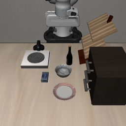
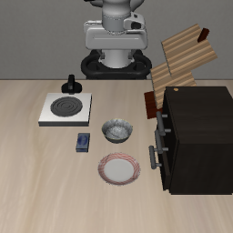

# LIBERO のタスク定義とシーン生成

調査日: 2026-10-13。対象は `hf-libero`（`.venv/lib/python3.12/site-packages/libero/libero/`、以下 `libero/`）。

## 1. ファイルの構成

| 場所 | 内容 |
|---|---|
| `libero/bddl_files/<スイート>/<タスク名>.bddl` | タスク定義（シーンの物体・配置範囲・初期条件・成功条件） |
| `libero/init_files/<スイート>/<タスク名>.pruned_init` | 初期状態（MuJoCo の状態ベクトル）50 件 |
| `libero/benchmark/__init__.py` | スイート（ベンチマーク）の登録。`register_benchmark` と `Task` |
| `libero/benchmark/libero_suite_task_map.py` | スイートごとのタスク名一覧 |
| `libero/envs/bddl_base_domain.py` | BDDL を読んでシーンを組み立て、物体を配置する基底クラス |
| `libero/envs/problems/` | シーンの種類（台所・リビング・書斎など）ごとのクラス |
| `libero/envs/objects/` | 物体モデル（50 種類） |
| `libero/benchmark/mu_creation.py`、`libero/utils/task_generation_utils.py` | BDDL をプログラムで生成する仕組み（シーンのテンプレートとタスク情報から書き出す） |
| `~/.cache/libero/assets/` | 物体・テクスチャのメッシュ（初回起動時に HF Hub から取得） |

## 2. BDDL の構造

例: `libero_goal/put_the_wine_bottle_on_top_of_the_cabinet.bddl`（抜粋）

```lisp
(define (problem LIBERO_Tabletop_Manipulation)   ; シーンの種類（envs/problems のクラス名に対応）
  (:domain robosuite)
  (:language Put the wine bottle on the top of the drawer)
  (:regions
    (wine_bottle_region                           ; 配置範囲（テーブル座標の矩形 x_min y_min x_max y_max）
      (:target main_table)
      (:ranges ((-0.21 -0.06 -0.19 -0.04))))
    (cabinet_region
      (:target main_table)
      (:ranges ((0.02 -0.25 0.04 -0.23)))
      (:yaw_rotation ((3.1416 3.1416))))          ; 向き（z 軸回りの回転範囲）
    (top_side (:target wooden_cabinet_1))         ; 物体側の領域（物体モデルが定義するサイト）
    ...)
  (:fixtures                                      ; 動かない物体（テーブル・棚・コンロなど）
    main_table - table
    wooden_cabinet_1 - wooden_cabinet ...)
  (:objects                                       ; 動かせる物体
    wine_bottle_1 - wine_bottle
    akita_black_bowl_1 - akita_black_bowl ...)
  (:obj_of_interest wine_bottle_1 wooden_cabinet_1_top_side)
  (:init                                          ; 初期条件
    (On wine_bottle_1 main_table_wine_bottle_region)
    (On wooden_cabinet_1 main_table_cabinet_region) ...)
  (:goal                                          ; 成功条件
    (And (On wine_bottle_1 wooden_cabinet_1_top_side))))
```

- シーンの種類（`problem`）: `LIBERO_Tabletop_Manipulation`（20 タスク）、`LIBERO_Kitchen_Tabletop_Manipulation`（50）、`LIBERO_Living_Room_Tabletop_Manipulation`（32）、`LIBERO_Study_Tabletop_Manipulation`（18）、`LIBERO_Floor_Manipulation`（10）
- 述語: `on`、`in`、`open`、`close`、`turnon`、`turnoff`、`up`（`true`、`false`、`printjointstate` もある）。`:init` と `:goal` の両方で使う
- 物体（50 種類）: `akita_black_bowl`、`alphabet_soup`、`basin_faucet`、`basket`、`bbq_sauce`、`black_book`、`bowl_drainer`、`butter`、`chefmate_8_frypan`、`cherries`、`chocolate_pudding`、`cookies`、`corn`、`cream_cheese`、`desk_caddy`、`dining_set_group`、`faucet`、`flat_stove`、`glazed_rim_porcelain_ramekin`、`ketchup`、`macaroni_and_cheese`、`mayo`、`microwave`、`milk`、`moka_pot`、`new_salad_dressing`、`orange_juice`、`plate`、`popcorn`、`porcelain_mug`、`rack`、`red_coffee_mug`、`salad_dressing`、`short_cabinet`、`short_fridge`、`slide_cabinet`、`target_zone`、`tomato_sauce`、`white_bowl`、`white_cabinet`、`white_storage_box`、`white_yellow_mug`、`window`、`wine_bottle`、`wine_rack`、`wooden_cabinet`、`wooden_shelf`、`wooden_tray`、`wooden_two_layer_shelf`、`yellow_book`

### 指示文はファイル名から作られる

ポリシーに渡る指示文（`Task.language`）は、BDDL の `(:language ...)` ではなく、`benchmark/__init__.py` の `grab_language_from_filename` がファイル名から作る（`_` を空白に置き換え、`.bddl` を除く。libero_10・libero_90 は `SCENE<n>_` より後ろ）。

- 例: ファイル名 `put_the_wine_bottle_on_top_of_the_cabinet.bddl` → 指示文 `put the wine bottle on top of the cabinet`。BDDL の `(:language ...)` は `Put the wine bottle on the top of the drawer` で、一致しない
- カスタムタスクでは `Task.language` を自分で指定できるため、ファイル名に縛られない

## 3. シーンの組み立てと物体の配置（`envs/bddl_base_domain.py`）

reset のたびに、`:init` の条件に従って物体を配置する（`_add_placement_initializer`、`_reset_internal`）。

| 初期条件 | 配置のしかた |
|---|---|
| `(On <固定物> <テーブルの領域>)` | 領域の矩形内にランダム配置（`MultiRegionRandomSampler`。他の物体との重なりは確認しない） |
| `(On <物体> <テーブルの領域>)` | 領域の矩形内にランダム配置（シーンの種類ごとのサンプラー） |
| `(On <物体> <物体の領域>)` | 他の物体のサイト（例: 棚の上面）の範囲内に配置（`SiteRegionRandomSampler`） |
| `(On <物体> <物体>)` | 他の物体の上に配置（`ObjectBasedSampler`） |
| `(In <物体> <物体の領域>)` | 容器の内部（引き出し・バスケットなど）に配置（`InSiteRegionRandomSampler`） |
| `(Open/Close <物体>)`、`(TurnOn/TurnOff <物体>)` | 関節（引き出し・扉・コンロのつまみ）の初期角度 |

- 座標: テーブル座標（m）。agentview の画像では、x が負の方向が奥（ロボット側、画像の上）、y が負の方向が画像の右
- 領域の矩形は多くが 2 cm 四方程度と小さく、初期配置のばらつきは小さい
- 固定物と重なる位置を指定しても配置時には弾かれず、シミュレーションの物理で押し出される（下の例を参照）

## 4. 初期状態（`.pruned_init`）

- 中身は `numpy.ndarray`（例: `put_the_wine_bottle_on_top_of_the_cabinet.pruned_init` は形状 `(50, 79)`、float64）。1 行が MuJoCo の状態ベクトル（時刻、全関節の位置 `qpos`、速度 `qvel`）で、次元は物体の構成で決まる
- 評価では、BDDL に従った配置のあと `env.set_init_state(state)` でこの状態に上書きする。エピソード i には i 番目（50 件で一巡）が使われるため、初期配置はファイルで固定される
- カスタムタスクでは物体の構成が変わるため、専用の初期状態ファイルが必要。作り方（確認済み）:
  1. `OffScreenRenderEnv(bddl_file_name=...)` を作り、`env.seed(i)` → `env.reset()` で配置をサンプリングする
  2. 何もしない動作（`[0, 0, 0, 0, 0, 0, -1]`）で数十ステップ進めて物体を落ち着かせる
  3. `env.get_sim_state()` を集めて `(N, D)` の配列にし、`torch.save` で保存する
- 元の LIBERO の `.pruned_init` は、不安定な配置を取り除いた（pruned）ものと考えられる。カスタムタスクでも、物体が倒れた・重なった配置を除く確認が必要

## 5. カメラ

| カメラ | 位置・向き | 本研究での意味 |
|---|---|---|
| `agentview` | テーブル手前（x=0.66、z=1.61）から、奥のロボット側を見下ろす（`problems/*_manipulation.py` の `_setup_camera`） | 固定視点。背の高い物体の奥（x が小さい側）は隠れる |
| `robot0_eye_in_hand` | グリッパーに固定 | ロボットの動きで視点が変わる。agentview から隠れた物体が見える場合がある |

評価の観測では、どちらも上下左右が反転した画像として返る（LeRobot の `LiberoProcessorStep` が 180 度回転して戻す）。

## 6. 隠れた物体の配置の試行（2026-10-13）

`put_the_wine_bottle_on_top_of_the_cabinet.bddl` の `wine_bottle_region` だけを `(-0.21 -0.06 -0.19 -0.04)` から `(-0.05 -0.20 -0.03 -0.18)` に変え、reset 後の agentview 画像を確認した。

| 元のタスク | ボトルの配置を変えたもの |
|---|---|
|  |  |
| ボトル（中央）は (-0.214, -0.047, 0.899) | ボトルは画像から見えない。位置は (-0.034, -0.121, 0.979) |

- ボトルはキャビネット（中心 (0.04, -0.234)）の奥に隠れ、agentview から見えなくなった
- ただし指定した y=-0.19 はキャビネットと重なる位置で、物理で y=-0.12 に押し出され、高さも元より 8 cm 高い（キャビネットに乗り上げている可能性がある）。正しく隠すには、固定物と重ならない位置（キャビネットの奥側の空き）を選び、配置後の位置と姿勢を確認する必要がある
- 「BDDL の配置範囲を変えるだけで、隠れた物体のシーンを作れる」ことは確認できた
