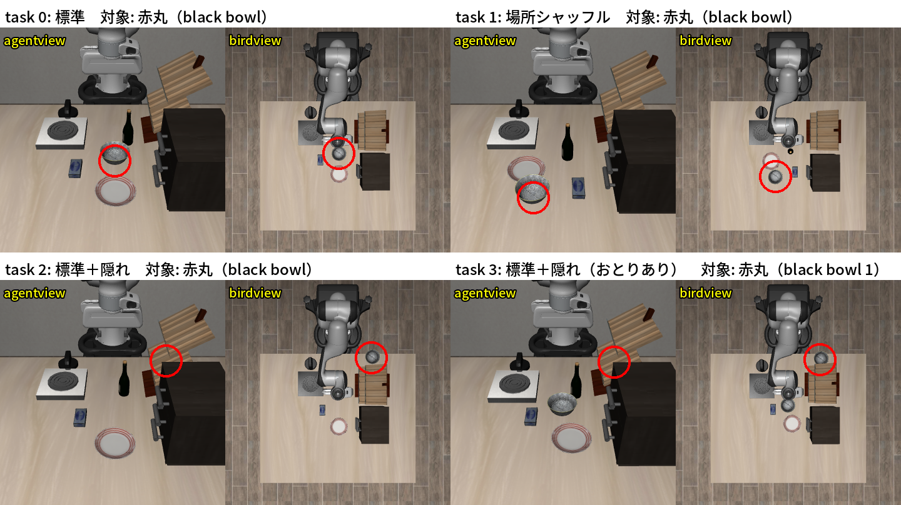

# experiments.md — VLA×3DSG 各実験の設定と結果

進捗・方針・既知の問題は `progress_management.md`（用語の ※ もそちら）。本ファイルのパスは `vla3dsg/` からの相対パス。表の細かい数値は各結果の `README.md` にあり、ここには結論・判断の理由・うまくいかなかった方法を残す。

## 1. 環境構築とベースライン

#### 1-1. MolmoAct2 のベースライン（`results/baseline/all40_n5/`）

- 概要: LIBERO の 4 スイート全 40 タスク × 各 5 エピソード※6 を、追加学習なしの MolmoAct2 で評価した
- 結果: 97.0%（194/200）。spatial 96%・object 100%・goal 98%・libero_10 94%（報告値 97.8・100・97.8・93.2%）。失敗 6 件はすべて時間切れ
- 読み取れること: 報告値を再現できており、以降の比較の基準にできる。報告値と同じ規模（500 エピソード）の評価は行わない（ユーザーと合意）

#### 1-2. 推論時間・GPU メモリ（`results/baseline/inference/`）

- 結果: 10 ステップ分の動作をまとめて出す推論が中央値 189ms、GPU メモリのピーク約 26GB。このPC（32GB）で評価できる

#### 1-3. デモ動画（`results/baseline/demo_video/`）

- 4 スイート × 2 タスク × 各 20 エピソードで 99.4%（159/160）。失敗は libero_goal task 0 の 1 件（引き出しの取っ手付近で止まって時間切れ）

## 2. 追加学習なしで SG を指示文に加える

2-1 はスイート `custom_tasks/vla3dsg_goal/`（libero_goal「put the bowl on the plate」を元にした 4 シーン）で、各条件 20 エピソード評価した（2026-10-21、学習サーバの GPU 4 枚）。結果は `results/zeroshot/<シーン>/<条件>/`。以前の libero_spatial などでの実験は、これで置き換えたため削除した（ユーザーの方針）。

| シーン | 配置 |
|---|---|
| ボウル1個,標準位置 | libero_goal task 8 の公式の初期状態のまま |
| ボウル1個,4物体シャッフル | 4 物体を学習にない場所へ移動（皿→クリームチーズの位置、ボウル→手前左、クリームチーズ→皿の位置、ワイン瓶→ボウルの位置） |
| ボウル1個,隠れ（評価用） | ボウルをワインラックの裏に置く（agentview※3 から見える割合 0%） |
| ボウル2個,見えるボウル=標準位置,隠れた方が正解（おとり※4 は見える方） | 上に加え、見えるボウル 2 を標準のボウルの位置に置く |
| ボウル2個,見えるボウル=標準位置,見える方が正解（task 4） | 上と同じ配置で正解とおとりを入れ替える（正解は標準の位置、おとりはワインラックの裏）。追加学習後の評価にだけ使う（4-2・4-3） |

- 隠れているかの判定は、カメラから対象の表面の点（最大 400 点）へ光線を飛ばし、遮る物体をどけた場合に対して何 % が直接見えるかで測る。セグメンテーション画像は、この環境（numpy 2、EGL）では robosuite・`mujoco.Renderer` とも正しく描けないため
- 何をどこに置いたかは、エピソードの開始時と終了時の SG を比べて集計する（`summarize_results.py` の outcomes）。皿の上のボウルを SG が on と判定できていない誤りがあり、LIBERO の成功判定と同じ条件も使うよう直した

#### 2-1. 4 シーン × 3 条件（`results/zeroshot/comparison.md`）

- 概要: 4 シーンで、3 つの指示文の条件（SG は三つ組）を比べた。最大ステップ数はボウル1個,標準位置・ボウル1個,4物体シャッフル 300、隠れた 2 シーン 400（2026-10-26 に 400 で評価し直した。300 のときと成功率は同じ 0%、置いたものの内訳もほぼ同じ）
- 目的: 公式の指示文に場所の関係がないタスクで、SG を加えると追加学習なしで使われるかを確かめ、追加学習ありの基準にする
- 指示文の例（ボウル2個,見えるボウル=標準位置,隠れた方が正解。全シーンは `results/zeroshot/conditions/prompts.md`）: base `put the bowl on the plate`、base_short `... scene information: (black bowl 1, behind, wine rack)`、base_wrong `... (black bowl 1, left of, wooden cabinet)`（おとりの関係。SG の中身が使われているかの対照）

| 条件 | ボウル1個,標準位置 | ボウル1個,4物体シャッフル | ボウル1個,隠れ（評価用） | ボウル2個,見えるボウル=標準位置,隠れた方が正解 |
|---|---|---|---|---|
| base（公式） | 95% | 10% | 0% | 0% |
| base_short（＋短い SG） | 100% | 45% | 0% | 0% |
| base_wrong（＋誤った SG） | 100% | 40% | 0% | 0% |

- 読み取れること:
  - 標準では、SG を付けても邪魔にならない
  - ボウル1個,4物体シャッフルでは、SG を付けると 10% から 45% に上がる（p = 0.03）。ただし base_wrong（ボウルが 1 つなので、誤った場所でも別の物体へ誘導できず、実質的に中身が役に立たない文）も 40% で、正しい短い SG と差がない（p = 1.0）。上がったのは中身ではなく、公式の文に何かを付け足すことによる（なぜ上がるかは原因不明）
  - ボウル1個,4物体シャッフルの失敗の多くは、ボウルを皿の上まで運んでも成功判定にならないまま時間切れで、動作の失敗。原因は 2-2（ボウルが学習時よりロボットから遠い）
  - 隠れたボウルは、どの条件でも取りに行かない。おとりがあれば 60 回中 59 回見えているボウル 2 を置き、なければクリームチーズを置くか止まる。追加学習なしでは、テキストの SG の中身は使われない
  - 以前は SG の書き方（JSON・自然文）、すべての関係の SG、同じ長さの無関係な文、SG から作った指示文も比べたが、どれも結論（追加学習なしでは SG の中身は使われない）を変えなかったため、結果と条件を削除した（2026-11-17）

#### 2-2. ボウル1個,4物体シャッフルで公式の指示文が 10% になった原因（`results/zeroshot/layout_check/`）

- 概要: 標準の配置から、ボウルか皿の一方だけを動かした 7 シーン（`custom_tasks/vla3dsg_goal_layout/`）で、公式の指示文のみを各 20 エピソード評価した（2026-10-22、このPC）
- 目的: どの物体の移動によるか、ロボットからの距離とボウル・皿の間の距離のどちらによるかを切り分ける
- 結果（距離は初期状態 0 での水平距離。表は README）: 皿を左・遠く・ボウルの隣へ動かす、ボウルを近くへ動かすと 95〜100%（ロボットからボウルまで 0.06〜0.12m）。ボウルをロボットから遠い手前（0.30〜0.38m）に置くと、皿の隣（ボウルと皿 0.11〜0.12m）でも離して（0.23m）も 0〜5%。スクリプト制御はどのシーンもできる（3〜5/5）
- 読み取れること:
  - ボウル1個,4物体シャッフルでの低下は、ボウルが学習時よりロボットから遠いことによる（皿の位置・ボウルと皿の近さは関係ない）
  - 失敗の仕方は、学習時のボウルの位置の上で止まる、ボウルを置いたまま皿の方へ行く、クリームチーズを皿に置く、ボウルを皿の縁に置く、とばらばら（動画で確認した一部）。学習時の配置での動きをなぞっている可能性がある（未検証）
  - 試した遠い位置はすべてテーブルの手前（カメラ側）で、左右に遠い場合は確かめていない
  - 公式の学習データ（`lerobot/libero`。MolmoAct2-LIBERO の正規化の統計のフレーム数 273,465 と一致する）で最初に掴んだ手先の位置: 「put the bowl on the plate」の 49 本はほぼ一定（x −0.12〜−0.06、ばらつき約 1cm、開始時の手先から 0.10〜0.15m）。libero_goal 全 428 本でも x 0.00 より手前に来ない。ほかのスイートでは x 0.16（最大 0.39m）まで掴んでおり、腕を伸ばす動き自体は学習データにある。libero_goal ではボウルがいつも同じ場所にあるデモしか見ていないことが原因と考えられる（推測）
  - スクリプト制御: ボウルが遠いと、既定の掴み方（手先を 90° 回してロボット側の縁を掴む）では皿へ戻す途中で手先が止まり、皿の縁に置いてしまう（0/5）。手先を回さずに横の縁を掴むと成功する（3〜4/5）

## 3. 追加学習の準備

#### 3-1. 学習が回るかの確認（`results/training/train_check/`）

- 概要: 公式のデモ（`lerobot/libero`）で、`MolmoAct2-LIBERO` を LoRA※7 で短く学習した
- 結果: このPC（RTX 5090）でバッチ 8・GPU メモリのピーク 29.7GB（32.6GB 中）、1.63 秒/8 サンプル。学習後のチェックポイントを評価で読み込めた。学習サーバでも 1 枚・2 枚で動いたが、他のユーザーの使用で 5090 より遅かった（2 枚で 7.14 秒/16 サンプル）
- 読み取れること: このPCで学習できる。メモリの余裕は約 3GB で、SG で指示文が長くなると足りなくなる可能性がある（その場合はバッチを下げるか学習サーバを使う）
- 注意: `--steps` はマイクロバッチ※8 の数（勾配累積 4 なら更新は 1/4）。チェックポイントは 1 つ 12GB。ログの勾配ノルム（`grdn`）が 0.000 なのは、MolmoAct2 がパラメータのグループごとに勾配を切り詰めて全体の勾配ノルムを計算しないためで、学習は止まっていない。目安として、実効バッチ 32 で 1 万回更新すると約 18 時間

#### 3-2. スクリプト制御によるデモ（`results/demos/check_goal/`）

- 概要・結果: スイート `vla3dsg_goal` の 4 タスクで、評価の初期状態でスクリプト制御※5 が各 10/10 成功（標準 123〜133、ボウル1個,4物体シャッフル 142〜153、隠れ 260〜324 ステップ）
- 以前の電子レンジのシーン（削除）で作ったデモ 200 本は、公式デモより長く（約 1.5〜2.3 倍）、手先が止まっている割合が多く（7〜19%、公式 2%）、学習の最初の損失も高かった（約 0.7、公式 約 0.08）。同じスクリプト制御の新しいデモにも同じ癖が出ており（3-5）、学習への影響は未検証
- スクリプト制御をこの形にした理由（以前のデモで分かったこと）:
  - 開いた指は初期の向きでは y 方向に並ぶ。ロボット側（x 方向）の縁を手先を回さずに掴むと、片方の指が縁に乗って下りられず、目標に届くまで押し続けていた（エピソードの約半分が止まった状態、学習の最初の損失 約 1.0）。手先を 90° 回して指が縁の壁を挟むようにし、手先が止まったら次の動作へ進むようにした
  - 固定物の裏では、手先を回すと前腕や指が固定物に当たることがあり、y 方向の縁を回さずに掴む（ワインラックの裏は回すと 3/8、回さないと 8/8）
  - 1 軸ずつ上限で動き、回転の指令が常に 0 だったため、3 軸まとめた速さ・変化量の制限、向きの補正と揺らぎを加えた。勢いが残って掴み損ねないよう、掴む・置く直前の 3cm だけゆっくり下ろす
  - 斜めに下りながら近づくと固定物の角に当たることがあり、水平に動いてから下ろす
  - 固定物の裏から皿へまっすぐ運ぶと引っかかるため、手前を回る経由点が必要（経由点なしでは 10 件中 4 件しか成功しなかった）

#### 3-3. スクリプト制御のランダム化（`results/demos/check_goal_random/`）

- 概要: デモの多様性のため、4 つのランダム化を入れた（2026-10-26、ユーザーと決定）。掴む向き（縁に沿って角度を変え、手先の向きを合わせる）、高さ（近づく・運ぶ・経由点、±3cm）、途中の経由点（半分の確率で横に ±8cm ずらした点を足す）、速さ（0.7〜1.0 倍）。ずれから立て直す動きは、記録の仕方の設計が必要なため後回し
- 掴む点を中心から外へずらす方法は、5mm でも半分ほど掴み損ねるため使わず、縁に沿って回す方法にした。掴める向きの範囲はシーンごとに違うため、30° ごとに試して決めた（標準 −60〜150°、ボウル1個,4物体シャッフル 120〜270°、隠れ 75〜120°）
- 結果: 4 シーンで 9〜10/10。隠れた 2 シーンは 273〜365 ステップで、半分以上が以前の最大ステップ数（300）を超える
- 読み取れること: 隠れたシーンのデモを偏りなく作るため、`vla3dsg_goal` の最大ステップ数を評価・デモとも 400 にした（2026-10-26、ユーザーと決定）

#### 3-4. 学習用のシーン（`custom_tasks/vla3dsg_goal_train/`、`results/demos/check_goal_train/`）

- 概要: 追加学習のデモを作る 4 シーン（2026-10-26〜28、ユーザーと決定）。指示文はすべて「Put the bowl on the plate」、最大 400 ステップ、各 50 の初期状態
  - wide: 見えるボウルを広い範囲に置く（2-2 の遠い位置で失敗する問題への対策）
  - hidden: ワインラックの裏（評価の hidden と同じ）
  - hidden_decoy: 隠れた正解＋見えるおとり（おとりは広い範囲）
  - decoy_visible: 見える正解（広い範囲）＋隠れたおとり
- hidden_decoy と decoy_visible は指示文が同じで、どちらのボウルが正解かは SG を読まないと分からない（SG なしのモデルは 50% が上限）。SG の効果は主にこの組で見る
- 2 か所目の隠し場所は作らない（ユーザーの方針）。木のキャビネットの裏はワインラックとの隙間が x 方向に 3.4cm しかなくボウル（直径約 11cm）が入らず、ラックにもたれる。コンロは高さ約 7cm で隠れない。物体を足す・ラックを動かす案は見送り。このため、おとりのない hidden は SG を読まなくても「見えなければラックの裏」で解けてしまう
- 見えるボウルは位置で掴める向きが違う（ロボット寄りは 0〜150°、遠い左手前は 180° 付近だけ。16 か所で調べた）ため、ボウルの x で範囲を切り替える（`DEMO_TASK_SPECS` の `grasp_angles_by_x`）
- 広い範囲は他の物体と重なるため、`make_custom_task.py --min-distance` で、近すぎる・乗った・触れた・読み込んで待つと動く配置を除いた（1 タスクあたり約 200 件を除外）
- 結果: 4 シーンともスクリプト制御で 10/10（137〜367 ステップ）。正解のボウルが見える割合は、見えるシーンで 99〜100%、隠れたシーンで 0%
- 読み取れること: 見えるボウルの位置は、ほかの物体を避けて 3 つのまとまり（標準の付近、ロボット寄りの左、遠い左手前）になり、一様には散らばらない

#### 3-5. 学習用のデモの生成（`results/demos/goal_train/`、データは `data/goal_train/`）

- 概要: 3-4 の 4 シーンで、スクリプト制御（ランダム化あり）のデモを各 50 本、計 200 本（47,562 フレーム）作った（2026-10-28、このPC で 52 分）。配置は評価の初期状態とは別のシードで選び、評価の初期状態と同じ基準（`min_distance`）で除く
- 結果: どのシーンも 98% 以上の試行で成功（失敗・400 ステップ超えは計 5 本で、保存しない）。ステップ数は、見えるボウル 126〜233、隠れたボウル 260〜399。公式デモ（同じタスクの 20 本）と比べると、見えるボウルのデモは平均 162 ステップで約 1.7 倍長く、移動の指令が上限に達しない（公式は x・z で 12〜14%）、手先が止まっている割合は 8〜13%（公式 6%）
- 読み取れること: 学習データとして使える。スクリプト制御の遅さの癖が学習したモデルに移り、最大ステップ数に収まらなくなる可能性がある（未検証）

## 4. 追加学習

隠れたシーンの条件: 対象は、評価の待ち（50 ステップ）の後に agentview・手首カメラのどちらにも映らないこと（`make_custom_task.py --occluder` が見える点が `settings.CUSTOM_TASK_HIDDEN_MAX_VISIBLE_POINTS` を超える配置を除く）。4-4・4-5 の `vla3dsg_kitchen4` はこれを満たさず、ワインラックの裏のボウルが最初から手首カメラに映っていた（`tasks.json` の `wrist_visible_ratio_first` 1.0）。agentview から見える割合だけを確かめていたため、見落とした（4-5）。4-6 から、2 か所の隠れたボウルの位置を変えて満たす

#### 4-1. SG なしで、見えるボウルを広い範囲に置いたデモで学習（`results/training/visible_nosg/`）

- 概要: 3-5 のデモのうち、正解のボウルが見える 2 シーン（wide・decoy_visible、100 本・16,222 フレーム）で、`MolmoAct2-LIBERO` を LoRA で追加学習した（2026-10-29、このPC で 5 時間 13 分）。有効バッチ 32（8 × 勾配累積 4）、12,000 ステップ ＝ 更新 3,000 回（約 6 周）、学習率の予定は学習の長さに合わせた（`run.sh`）。公式デモは混ぜない
- 目的: SG を考える前に、そもそも追加学習が効くか、学習前に失敗していた遠いボウル（2-2）を掴めるようになるかを確かめる
- 結果（各 20 本、公式の指示文のみ）:

| シーン | 学習前 | 更新 1,000 回 | 更新 3,000 回 |
|---|---|---|---|
| 見えるボウル=ランダム（2シーン） | 16/40 | 32/40 | 32/40 |
| ボウル1個,遠い位置（3シーン） | 2/60 | 44/60 | 41/60 |
| ボウル1個,標準位置 | 19/20 | 20/20 | 20/20 |

- 読み取れること:
  - 学習が効き、遠いボウルを掴めるようになった（学習用シーンの遠い左手前は 1/25 → 17/25、ロボット寄りは学習前から 15/15）。学習のデモにない配置（皿の隣など、学習用シーンでは除いた配置）でも上がる
  - 標準は下がらない（公式デモを混ぜなくても、このタスクは忘れない。ほかの libero_goal のタスクは未評価）
  - 更新 1,000 回と 3,000 回で差はほぼない。このデータ量なら 1,000 回（約 1.7 時間）で足りる可能性がある
  - 失敗（3,000 回の遠いボウル 19 本）は、開いたままボウルの中心の上で止まる 8 本、ボウルの近くから皿の上へ動いて止まる 6 本、空中でグリッパーを閉じて浮いたまま止まる 5 本。成功した回は手先が縁の上に来るが、失敗した回は中心の上に来ることが多い。掴み直す動きはない（デモに立て直す動きがないため）。最も遠い「ボウル1個,遠く」は 50〜55% にとどまる
  - 評価では、手首カメラの名前を学習データ（`lerobot/libero` と同じ形式）に合わせる必要がある（`run_eval.py --policy-path` が `--rename_map` で `wrist_image` → `image2` にする）

#### 4-2〜4-5. 隠れたシーンの学習の経緯（結果・データ・チェックポイントは 4-6 で上位互換が得られたため削除。git の履歴にある）

- 4-2（libero_goal の 4 シーン、隠し場所 1 か所）: おとりのあるシーンでは SG が効いた（隠れた方が正解: SG なし 30〜35% → SG あり 85%）。ただし隠れたボウルは SG なしでも掴めた（隠し場所が 1 か所なら場所を覚えれば足りる）。さらに、見えるボウルを無視してワインラックの裏へ行く癖がつき、標準のシーンが 95% → 40〜65% に下がった
- 4-3（見えるボウルのデモの追加＋公式デモ）: 癖はほぼなくなった。ただし、標準の位置（公式デモで必ず掴む位置）におとりがあると、SG に関係なく標準の位置を掴んだ。公式デモを混ぜる方法は、標準の位置に別のボウルがあるシーンと相性が悪い
- 4-4（KITCHEN_SCENE4 で隠し場所 2 か所、`custom_tasks/vla3dsg_kitchen4/`）: SG がないとどちらの隠し場所か分からない条件にした。隠れた 2 シーンで SG なし 22/40、SG あり 36/40。SG なしの失敗のほとんどは隠し場所の取り違えだった。デモは公式と違う動き（手首を大きく回す）の古いスクリプト制御で作った
- 4-5（デモを 5-2 の作り方で作り直す）: SG ありに誤った SG（もう一方の隠し場所の裏）を与えると 0/40 で、SG を読んでいた。しかし SG なしも 39/40 だった。ワインラックの裏のボウルが最初のコマから手首カメラに映り、画像だけで 2 シーンを見分けられたため（この節の冒頭の条件を作るきっかけ）

#### 4-6. 隠れたボウルをどちらのカメラにも映らない位置へ動かして、SG なし／ありを学習（`results/training/kitchen4_v3_sg_vs_nosg/`）

- 概要: 4-5 の 3 シーンのうち、隠れた 2 シーンのボウルの配置範囲を、評価の待ちの後にどちらのカメラにも映らない位置へ動かした（全 50 配置で見える点 0）。ワインラックの裏は y を -0.05、キャビネットの裏は y を +0.05 動かした。隠れた 2 シーンのデモを 5-2 の作り方で作り直し（各 50 本、`data/kitchen4_v3_hidden`）、4-5 の見えるボウルのデモ 100 本（`kitchen4_v2_wide`）と合わせて 200 本（30,468 フレーム）にした。公式デモは混ぜない。誤った SG はもう一方の隠し場所の裏。このPC（RTX 5090 × 1）で、4-5 と同じ合計バッチ 32（8 × 勾配累積 4）、更新 6,000 回で SG なし・SG ありを学習した。1,000 回ごとに 3 シーン × 20 本で評価した（2026-11-20 12:37〜11-21 12:26。学習は 1 モデル約 10.5 時間、評価は 1 シーン約 4.5 分）
- 目的: 画像に隠し場所の手がかりがない条件で、SG の効果を確かめる
- 結果（隠れた 2 シーンの合計 /40。括弧内はワインラックの裏／キャビネットの裏、見えるボウル /20）:

| 更新回数 | 1,000 | 2,000 | 3,000 | 4,000 | 5,000 | 6,000 |
|---|---|---|---|---|---|---|
| SG なし | 30（12／18）・19 | 20（0／20）・20 | 19（3／16）・20 | 19（5／14）・17 | 20（10／10）・19 | 19（2／17）・20 |
| SG あり | 36（19／17）・19 | 37（19／18）・20 | 32（15／17）・20 | 31（14／17）・20 | 33（17／16）・18 | 37（19／18）・19 |
| SG あり＋誤った SG | | | | | | 0（0／0）・19 |

- 読み取れること:
  - 隠れた 2 シーンで、SG ありが SG なしを大きく上回る（更新 6,000 回で 37/40 対 19/40、フィッシャーの正確検定 p < 0.0001）。見えるボウルはどちらも 19〜20/20
  - SG なしは学習を続けても約 50%（19〜20/40）にとどまる。2 か所の隠し場所のどちらかを選ぶ当て推量の水準で、2,000 回では毎回キャビネットの裏へ行く（0／20）
- 失敗の内訳（更新 6,000 回、全 24 本の動画のコマを目視。失敗はすべて 400 ステップの時間切れ）:

| モデル | 失敗 | もう一方の隠し場所へ行く | 正しい隠し場所で掴み損ねる | 隠し場所まで行かない |
|---|---|---|---|---|
| SG なし（ワインラックの裏） | 18 | 17（キャビネットの裏） | 1 | 0 |
| SG なし（キャビネットの裏） | 3 | 3（ワインラックの裏） | 0 | 0 |
| SG あり（ワインラックの裏） | 1 | 0 | 1（手首カメラにボウルが映る） | 0 |
| SG あり（キャビネットの裏） | 2 | 1（ワインラックの手前で止まる） | 0 | 1（キャビネットの手前の上で止まる） |

  - SG なしの失敗は 21 本中 20 本が隠し場所の取り違え。40 本中約 37 本でキャビネットの裏へ行き、ほぼ一方の隠し場所に決め打ちしている
  - SG ありの失敗 3 本のうち、取り違えは 1 本だけ
  - SG ありは SG を読んでいる。誤った SG では、隠れた 2 シーンで 0/40（毎回失敗）。見えるボウルは、誤った SG でも画像を優先して掴む（19/20）
  - SG ありは更新 1,000 回で 36/40 に達し、その後は 31〜37/40 で上下する。4-5 と違い、SG なしとの差は学習を続けても縮まらない
- 残っている問題: 隠し場所の位置が学習と評価で同じため、SG ありが「wine rack」という単語と決まった座標の対応を覚えただけの可能性を除けない → 隠し場所の物体を左右で入れ替えて学習・評価する（4-7、計画は `progress_management.md` の「次に行うこと」）

## 5. 目の前の 2 つの物体を SG で見分ける（段階 1。位置づけは `progress_management.md` の「研究の組み立て」）

スイート `custom_tasks/vla3dsg_spatial/`: libero_spatial の 5 配置（中央・引き出し・箱の隣・箱の上・ラメキンの上）の公式の初期状態をそのまま使い、各配置で正解を公式と同じボウル 1（`<配置>_b1`）と、もう一方のボウル 2（`<配置>_b2`、`make_custom_task.py --goal-object`）にした 10 タスク（最大 280 ステップ）。対の 2 タスクは画像がまったく同じで、違うのは正解のボウルだけ。ボウル 2 の指示文は、その位置を表す別の公式タスクの言い方を使う（例: 箱の上の配置で、棚の上のボウル → pick up the black bowl on the wooden cabinet and place it on the plate）。

評価で与える指示文（括弧内は条件名で、結果のフォルダ名。例は引き出しの配置で、棚の上のボウル（b2）が正解のとき）:

| 指示文 | 中身 | 例 |
|---|---|---|
| ① 公式（base） | LIBERO の言い方。ボウルの位置関係を人が書いている | `pick up the black bowl on the wooden cabinet and place it on the plate` |
| ② 位置関係なし（norel） | 位置関係を消した文。ボウルが 2 つあるため、これだけではどちらか分からない | `pick up the black bowl and place it on the plate` |
| ③ 位置関係なし＋SG（norel_short） | ② の後ろに、正解のボウルを見分ける最小の SG（三つ組）を付けた文 | `pick up the black bowl and place it on the plate. scene information: (black bowl 2, on, top of wooden cabinet)` |

学習したモデル（5-2・5-3）: SG なしモデルは自作のデモに ② を、SG ありモデルは自作のデモに ③ を付けて学習した（5-3 ではどちらにも公式デモを ① のまま混ぜた）。結果の表では「学習したモデル」と「評価で与えた指示文」を分けて書く。

#### 5-1. 学習前の評価（`results/zeroshot/spatial/`）

- 概要: 10 タスク × 2 条件 × 20 エピソード（2026-11-10、6000ada の GPU 4 枚）
- 目的: 元のモデルが位置関係の言葉で対象を見分けているのか（b2 を解けるか）、配置を覚えているだけなのかを確かめる
- 指示文の条件: ①・②（学習前は SG を読めないため、SG を加えた ③ は学習後だけ評価する）
- 結果（成功数/20。括弧内は失敗したときに皿に置いたボウル。b1 = 公式と同じ正解、b2 = もう一方）:

| 配置 | 正解 | ① 公式 | ② 位置関係なし |
|---|---|---|---|
| center | b1 | 20 | 20 |
| center | b2（next to the plate） | 2（b1 18） | 0（置かない 1、b1 19） |
| drawer | b1 | 20 | 16（置かない 4） |
| drawer | b2（on the wooden cabinet） | 0（b1 20） | 0（置かない 4、b1 16） |
| near_box | b1 | 20 | 16（b2 4） |
| near_box | b2（on the stove） | 20 | 4（b1 16） |
| on_box | b1 | 20 | 9（置かない 1、b2 9） |
| on_box | b2（on the wooden cabinet） | 20 | 8（置かない 1、b1 10） |
| on_ramekin | b1 | 20 | 17（置かない 3） |
| on_ramekin | b2（on the cookie box） | 19 | 0（置かない 4、b1 16） |
| b1 の合計（/100） | | 100 | 78 |
| b2 の合計（/100） | | 61 | 12 |

- 読み取れること:
  - 公式の言い方の位置関係には、一部従う。b2 は 5 配置中 3 配置で 95〜100%（near_box・on_box・on_ramekin）、残り 2 配置（center・drawer）は 0〜10% で、失敗はすべて公式の正解のボウル（b1）を皿に置く。同じ「on the wooden cabinet」でも on_box では 20/20、drawer では 0/20 で、言葉の理解は配置に左右される
  - 位置関係を外すと、ほとんどの配置で公式の正解のボウル（b1）を取る（b2 は 12/100）。言葉がないときは配置を覚えた動きになる（on_box だけはほぼ半々）
  - 「元のモデルでも関係の指示ができる」は半分正しい（自然文の関係には 5 配置中 3 配置で従い、center・drawer は解けない）。追加学習で SG を使えるようにし、b2 を ① 以上に解けるか（特に center・drawer）を示すのが段階 1 の目標になる

#### 5-2. 学習用のデモ（スクリプト制御を公式デモに近づける。`results/demos/spatial_v2_<配置>[_norel|_sg]/`、データは `data/spatial_v2_*`）

- 概要: `vla3dsg_spatial` の 10 タスクのスクリプト制御のデモ（各 30 本、計 300 本・38,381 フレーム。タスクごとの割合は 8〜12%）。指示文を ② にしたデータ（`_norel`）と ③ にしたデータ（`_sg`、`make_sg_dataset.py --condition norel_short`）を作り、5 配置を結合した（`spatial_v2_train_norel`・`_sg`）。公式デモ 432 本（`official_spatial_0〜9`、52,970 フレーム、指示文は ① のまま）を混ぜたもの（`spatial_v2_mix_norel`・`_sg`、91,351 フレーム）も作った（2026-11-13、このPC）
- 経緯（判断の理由）: 最初のデモで学習すると、SG ありは正解のボウルを選べるようになる（成功 123/200、違うボウル 32）が、掴んで置く動作が悪くなり（それ以外の失敗が学習前の 2〜20 → 45〜88/200）、学習前のモデルに ① を与えた場合（161）を下回った。最大ステップ数を倍（560）にしても成功は 4〜11 本しか増えず、時間切れではなかった。公式デモを混ぜても、① での力が戻るだけで、自作デモと組になった ②・③ では動作が悪いままだった（SG あり 102/200）。そこで自作デモを公式と比べ（`generate_demos.py --report`、各 20 本）、違いを直して作り直した。作り直したデモで学習すると劣化はほぼなくなり（5-3）、デモの動きが原因だったと分かった
- 最初のデモと公式の違い（掴むこと自体は正しく、掴み直しもない）:
  - 掴む前に手首を約 75° ひねる（公式は 0〜13°、引き出しだけ約 25°）。縁の壁を指で挟む向きを掴む縁の位置から決めていた（`rim_grasp`）ため。腕の姿勢と手首カメラの見え方が公式とまったく違った
  - 遅い: 長さは公式の 1.4〜2 倍、移動の指令は約半分で上限に達しない、手先が止まっているステップが 8〜20%（公式 3〜6%）。経由点ごとに止まりかけ、掴む・放す前後でそれぞれ 15 ステップ待ち、物体に当たって進めないと判定するまで 10 ステップ押し続けた
  - 半分の確率で、運ぶ途中に横へずれた経由点を足していた（寄り道）。学習したモデルが皿のあたりをさまよう失敗と似ていた
  - 箱の上の b1 とラメキンの上の b2（どちらもクッキーの箱の上のボウル）を同じシードで作ったため、動作がほぼ同一だった
- 公式の掴み方: 公式デモの閉じた時点の手先の位置を、評価の初期状態のボウルの位置と比べると、多くは左の縁（ボウルの中心から見て約 90°）を手首を回さずに掴む。引き出しは約 140° を約 25° 回して、ラメキンの上は約 -30° を掴む
- 変更（`settings.py`。`scripted.py` に途中の点で止まらずに通り過ぎる `SCRIPTED_PASS_TOL` と、待ちのステップ数の設定を追加）: 掴む向きを公式に合わせる（`DEMO_TASK_SPECS["vla3dsg_spatial"]` の `grasp_angles`・`grasp_yaw_deg`）、速さの上限 0.8 → 1.3、ゆっくり下ろす速さ 0.3 → 0.5、比例ゲイン 25 → 40、加速の上限 0.1 → 0.15、途中の点は 4cm 手前で次へ、放した後の待ち 15 → 5、止まった判定 10 → 5 ステップ、寄り道なし、配置ごとに別のシード（10 万・11 万・…）。閉じてから持ち上げるまでの待ち 15 → 10（6 まで縮めると、指が縁を挟みきる前に持ち上げて空振りし、デモの失敗 18 本中 11 本がこれだった）
- 結果（各 20 本の平均。最初のデモ → 作り直したデモ。b1 / b2）:

| 配置 | 公式の長さ | 長さ | 公式の最初に掴むまで | 最初に掴むまで | 公式の止まっている割合 | 止まっている割合 | 掴む時点の手首の回転（公式） |
|---|---|---|---|---|---|---|---|
| center | 116 | 168 / 191 → 103 / 114 | 42 | 68 / 106 → 41 / 63 | 6% | 9 / 12% → 3 / 5% | 約 75° → 0°（3°） |
| drawer | 147 | 213 / 228 → 147 / 154 | 51 | 91 / 91 → 67 / 60 | 3% | 20 / 14% → 15 / 9% | 約 75° → -25° / 0°（-25°） |
| near_box | 127 | 251 / 186 → 126 / 116 | 50 | 149 / 56 → 55 / 31 | 3% | 18 / 8% → 4 / 8% | 約 75° → 0°（-2°） |
| on_box | 101 | 187 / 239 → 126 / 151 | 43 | 96 / 97 → 59 / 59 | 3% | 10 / 16% → 5 / 9% | 約 75° → 0°（-3°） |
| on_ramekin | 114 | 168 / 187 → 115 / 130 | 33 | 57 / 96 → 41 / 63 | 3% | 9 / 10% → 7 / 6% | 約 75° → 0°（10°） |

- 読み取れること:
  - 長さ・掴むまでの時間・手首の向きは公式とほぼ同じになった。比較動画（`results/demos/spatial_v2_<配置>/videos/compare_with_official.mp4`）でも、腕の姿勢と手首カメラの見え方が公式と同じ
  - 引き出し b1 は止まっている割合がまだ 15%（公式 3%）。引き出しの中で掴む点まで下りきれずに当たって止まる
  - 移動の指令が上限に達する割合は公式より多い（y 軸で最大 27%、公式は 0%）。速さの上限を上げた影響
  - デモの失敗（保存しない）は 15/315。引き出し b1・箱の上 b2 は掴む点まで下りきれずに閉じる、ラメキンの上 b1 は下ろす途中で斜めに乗ったボウルを押して傾ける。失敗しやすい配置のデモが少し少ない可能性がある

#### 5-3. SG なし／ありを学習（`results/training/spatial_v2_sg_vs_nosg/`）

- 概要: 5-2 の自作デモだけで、指示文を ② にした SG なしモデルと、③ にした SG ありモデルを学習した。同じデモで、違うのは指示文だけ。6000ada の GPU 4 枚（1 枚あたりバッチ 8、合計 32）、更新 3,000 回（約 2.5 エポック）、学習率のスケジュールは 4-3・4-4 と同じ。更新 500 回ごとのチェックポイントを、学習と同じ指示文で 10 タスク × 20 エピソード評価し、最後（更新 3,000 回）だけもう一方の指示文でも評価した（2026-11-13、学習 3.0・3.2 時間、評価 140 本は 4 枚で 4.5 時間）。2026-11-18 に、SG ありモデルに誤った SG（条件 `norel_wrong`）を与える評価を追加した（`run_wrong.sh`、4 枚で 30 分）
- 目的: 関係を外した指示文に SG を加えて学習すると、SG を読んで正解のボウルを選べるようになるか（b1・b2 の両方を解けるか）を、SG なしと比べて確かめる
- 結果（成功数/100。各 5 配置 × 20 エピソード）:

| 更新回数 | SG なしモデル・② で評価 b1 | b2 | SG ありモデル・③ で評価 b1 | b2 |
|---|---|---|---|---|
| 500 | 36 | 43 | 55 | 71 |
| 1,000 | 42 | 38 | 80 | 80 |
| 1,500 | 38 | 44 | 81 | 95 |
| 2,000 | 42 | 46 | 78 | 92 |
| 2,500 | 36 | 53 | 82 | 95 |
| 3,000 | 38 | 42 | 81 | 92 |

- 更新 3,000 回の内訳（b1 と b2 の合計 /200。成功・違うボウルだけを皿に置いた・それ以外（どちらも皿にない、置いたが成功の判定に至らない））と、配置ごとの成功数（b1 / b2、各 /20）:

| 学習したモデル | 評価で与えた指示文 | 成功 | 違うボウル | それ以外 | center | drawer | near_box | on_box | on_ramekin |
|---|---|---|---|---|---|---|---|---|---|
| 学習前（5-1） | ① 公式 | 161 | 37 | 2 | 20 / 2 | 20 / 0 | 20 / 20 | 20 / 20 | 20 / 19 |
| 学習前（5-1） | ② 位置関係なし | 90 | 90 | 20 | 20 / 0 | 16 / 0 | 16 / 4 | 9 / 8 | 17 / 0 |
| SG なし | ② 位置関係なし（学習と同じ） | 80 | 77 | 43 | 8 / 5 | 1 / 17 | 15 / 4 | 6 / 14 | 8 / 2 |
| SG なし | ① 公式 | 110 | 53 | 37 | 7 / 8 | 2 / 18 | 15 / 12 | 7 / 16 | 12 / 13 |
| SG あり | ③ 位置関係なし＋SG（学習と同じ） | **173** | 11 | 16 | 20 / 18 | 15 / 19 | 19 / 18 | 18 / 18 | 9 / 19 |
| SG あり | ② 位置関係なし（SG を外した） | 90 | 82 | 28 | 12 / 8 | 10 / 7 | 7 / 12 | 8 / 12 | 12 / 2 |
| SG あり | 位置関係なし＋誤った SG（2026-11-18 に追加） | 19 | 145 | 36 | 11 / 1 | 0 / 1 | 1 / 0 | 1 / 2 | 0 / 2 |

- 読み取れること:
  - SG ありは、学習前のモデルに ① を与えた場合（161）を上回る（173/200）。学習前は ① でも解けなかった center・drawer の b2（2・0/20）を 18・19/20 解く。段階 1 の目標（SG で b2 を ① 以上に解く）を達成した
  - SG ありのモデルは SG を読んでいる。同じモデルで SG を外すと 173 → 90/200 に下がり、違うボウルが 11 → 82 に増えて SG なしと同じになる
  - 誤った SG（もう一方のボウルを見分ける関係を、対象の名前で書いたもの。例: 対象が中央のボウルのとき `(black bowl 1, left of, stove)`）を与えると、成功は 19/200 に下がり、違うボウルが 145/200 になる。SG に書かれた関係のほうのボウルを取りに行く。SG を外した場合（違うボウル 82）より大きく誤るため、文が付け足されていることではなく、SG の関係の中身でボウルを選んでいる。対象の名前（black bowl 1・2）は正しいままなので、名前から正解を覚えているのでもない
  - 動作の劣化はほぼなくなった（それ以外の失敗 16/200。最初のデモでは 45）
  - SG ありは更新 1,000〜1,500 回でほぼ頭打ち（160 → 176 → 170 → 177 → 173）
  - 残る失敗は、ラメキンの上の b1（9/20）と引き出しの b1（15/20）に多い。どちらもデモの失敗が多かったタスク（5-2）
  - 公式デモを混ぜていないため、SG なしモデルに ① を与えると 110/200 で、学習前（161）より下がる（最初のデモでは 73）
- 動画は 6000ada の `results/training/spatial_v2_sg_vs_nosg/*/step*/*/*/videos/`

#### 5-4. 公式デモを混ぜて更新 3,000 回で学習（結果・データ・チェックポイントは 5-5 で上位互換が得られたため削除。git の履歴にある）

- 5-5 と同じデータで SG なし・SG ありを 5-3 と同じ更新 3,000 回で学習した。SG なしモデルに ① で 154/200（5-3 は 110）と、公式デモを混ぜると ① の力が保たれた。SG ありは ③ で 163/200 とまだ上がっていたため、5-5 で更新回数を延ばした

#### 5-5. 公式デモを混ぜて SG ありを学習（`results/training/spatial_v2_mix_sg_6000/`）

- 概要: 5-2 の自作デモ（300 本、38,381 フレーム。指示文は ③）に、公式の libero_spatial の 10 タスクのデモ 432 本（52,970 フレーム。指示文は ① のまま）を混ぜ（計 91,351 フレーム。自作デモはフレーム数で 42%）、更新 6,000 回（約 2.1 エポック）、学習率の減衰 6,000 回で学習した。SG なしモデルは作らず、同じモデルで SG を外した ②・公式の ①・誤った SG と比べた（2026-11-18、6000ada の GPU 4 枚、学習 6.1 時間、評価 90 本 2.8 時間）。更新 3,000 回では ③ で 163/200 とまだ上がっていたため延ばした（5-4）
- 目的: 5-3 の自作デモだけの学習では、① での力が落ちた（SG なしモデルに ① で 110/200、学習前 161）。公式デモを混ぜて、① の力を保ったまま 5-3 と同じ SG の効果が得られるかを確かめる
- 結果（③ で評価した成功数。b1・b2 は各 /100）:

| 更新回数 | b1 | b2 | 計 /200 | 違うボウル |
|---|---|---|---|---|
| 1,000 | 61 | 63 | 124 | 33 |
| 2,000 | 80 | 72 | 152 | 31 |
| 3,000 | 83 | 81 | 164 | 15 |
| 4,000 | 76 | 88 | 164 | 14 |
| 5,000 | 81 | 90 | 171 | 12 |
| 6,000 | 85 | 89 | **174** | 10 |

- 更新 6,000 回の内訳（/200）と配置ごとの成功数（b1 / b2）:

| 学習したモデル | 評価で与えた指示文 | 成功 | 違うボウル | それ以外 | center | drawer | near_box | on_box | on_ramekin |
|---|---|---|---|---|---|---|---|---|---|
| 学習前（5-1） | ① 公式 | 161 | 37 | 2 | 20 / 2 | 20 / 0 | 20 / 20 | 20 / 20 | 20 / 19 |
| SG あり（5-3、公式デモなし） | ③ 位置関係なし＋SG | 173 | 11 | 16 | 20 / 18 | 15 / 19 | 19 / 18 | 18 / 18 | 9 / 19 |
| SG あり（5-5） | ③ 位置関係なし＋SG（学習と同じ） | **174** | 10 | 16 | 20 / 19 | 13 / 16 | 19 / 17 | 17 / 18 | 16 / 19 |
| SG あり（5-5） | ① 公式 | 159 | 32 | 9 | 20 / 4 | 19 / 2 | 20 / 20 | 18 / 19 | 19 / 18 |
| SG あり（5-5） | ② 位置関係なし（SG を外した） | 96 | 96 | 8 | 20 / 0 | 18 / 1 | 6 / 14 | 11 / 9 | 17 / 0 |
| SG あり（5-5） | 位置関係なし＋誤った SG | 25 | 137 | 38 | 15 / 0 | 1 / 3 | 3 / 1 | 1 / 1 | 0 / 0 |

- 読み取れること:
  - 学習を 6,000 回に延ばすと、公式デモを混ぜたまま ③ で 174/200 になり、5-3（173）と同じ。更新 3,000 回（163）で弱まっていたのは学習量の不足だった。更新 5,000〜6,000 回でもわずかに上がっているが、ほぼ頭打ち
  - 同じモデルに ① を与えると 159/200 で、学習前（161）と同じ。1 つのモデルで ① の力と SG の効果を両立できた。ただし ① では学習前と同じく center・drawer の b2 は解けない（4・2/20）。SG（③）ではこれを 19・16/20 解く
  - SG を外すと 96/200（違うボウル 96）、誤った SG では 25/200（違うボウル 137）。5-3 と同じく、SG の関係の中身でボウルを選んでいる
  - 残る失敗は引き出しの b1（13/20）に多い。5-3 で少なかったラメキンの上の b1 は 9 → 16/20 に上がった
- 違うボウルの数は `outcomes.md` から数えた（皿の上にもう一方のボウルだけがある）

#### 5-6. 人が書いた関係（①）の指示文で学習して、SG ありと比べる（`results/training/spatial_v2_base/`）

- 概要: 5-3 と同じデモ 300 本の指示文を ① にしたデータ（`spatial_v2_train_base`）で 1 モデルを学習し、500 回ごとに ① で評価した。最後だけ ② でも評価した。学習の設定は 5-3 と同じで、違いは GPU の数だけ（5-3 は 4 枚 × バッチ 8、今回は 2 枚 × バッチ 16。合計 32）（2026-11-25、6000ada の GPU 2 枚。学習 5.0 時間、評価 3.7 時間）
- 目的: 5-3 で比べた ①（161）は学習前のモデルの値で、追加学習の効果と SG の効果を切り分けられない。同じデモ・同じ設定で、指示文だけを人が書いた関係にしたモデルと比べ、SG が言葉の関係の代わりになるかを確かめる
- 結果（更新 3,000 回。成功数 /200、配置ごとは b1 / b2 の各 /20）:

| モデル | 評価の指示文 | 成功 | 違うボウル | それ以外 | center | drawer | near_box | on_box | on_ramekin |
|---|---|---|---|---|---|---|---|---|---|
| ① で学習 | ① 公式（学習と同じ） | **181** | 3 | 16 | 18 / 17 | 16 / 19 | 19 / 19 | 19 / 19 | 15 / 20 |
| ① で学習 | ② 位置関係なし | 91 | 85 | 24 | 19 / 1 | 4 / 11 | 12 / 8 | 1 / 18 | 14 / 3 |
| SG あり（5-3） | ③ 位置関係なし＋SG | 173 | 11 | 16 | 20 / 18 | 15 / 19 | 19 / 18 | 18 / 18 | 9 / 19 |

  更新回数ごと（/200）: ① で学習 178・170・179・180・183・181、SG あり（5-3）126・160・176・170・177・173

- 読み取れること:
  - SG ありは、同じデモで人が書いた関係を学習したモデルとほぼ同じ（173 と 181、p = 0.27）。SG は人が書いた関係の代わりになる
  - 差の大半は on_ramekin_b1（15 と 9）。失敗の動画を見ると、どちらのモデルも正しいボウルを持ち上げる途中で落とす失敗が多く、見分けではなく動作の問題。違うボウルを選んだのは ① で学習 3 本、SG あり 11 本で、見分けの精度は ① の方がわずかに高い
  - ① で学習したモデルも、関係を外すと当て推量に戻る（② で 91/200、違うボウル 85）。言葉の関係でボウルを選んでいる
  - ① は学習の初め（更新 500 回）から 178/200。学習前から ① の言い方を理解しているため。SG は学習で読み方を覚える必要があり、1,500 回で追いつく
