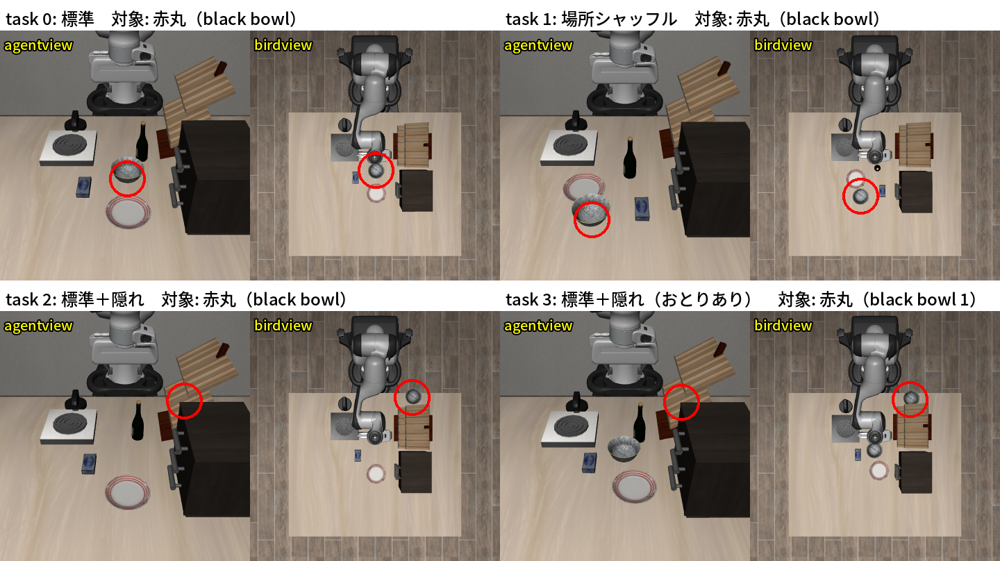

# progress_management.md — VLA×3DSG 進捗管理

最終更新: 2026-10-21

研究の概要・環境・リポジトリ構成は、リポジトリのルートの `CLAUDE.md` を参照。本ファイルのパスは、特に断りがない限り `vla3dsg/` からの相対パス。

## 研究目的

VLA※1 の言語指示に 3D シーングラフ（SG※2）の情報を加え、カメラ画像だけでは見えない（隠れた）物体も扱えるようにする。まずシミュレーション（LIBERO）上で、テーブルの上の隠れた物体を対象に検証する。

## 現在の設計方針

| 項目 | 方針 | 理由 | 決めた日 |
|---|---|---|---|
| 評価基盤 | 本家 LeRobot のフォーク（`vla3dsg` ブランチ、ベースは upstream `200ee535`。LeRobot 本体は変更しない） | LeIsaac での学習が安定しなかったため、評価に特化した LIBERO で体系的に検証する。本体を変えなければ upstream を取り込みやすい | 2026-10-06 |
| モデル | MolmoAct2（`allenai/MolmoAct2-LIBERO`、float32） | LeRobot 形式の `MolmoAct2-LIBERO-LeRobot` は `config.json` が現在の LeRobot と非互換で読み込めない | 2026-10-07 |
| 評価条件 | 環境タイプ `libero_vla3dsg`（`num_steps_wait=50`）、シード 1000、動画を保存する | MolmoAct2 の報告値と同じ条件にするため（LeRobot の既定は 10）。シード固定で同じエピソードが同じように失敗することを確認済み。成功率だけでは失敗の仕方がわからないため動画も残す | 2026-10-07 |
| 報告値の再現の規模 | 全 40 タスク × 5 エピソードで再現とみなし、報告値と同じ 500 エピソード規模の評価は行わない | 97.0%（報告値の平均 97.2%）で十分に一致したため（ユーザーと合意）。比較の基準は、実際に比べるタスクで同じ条件で取り直す | 2026-10-07 |
| 指示文の扱い | MolmoAct2 の指示文の正規化を切り（`--policy.normalize_language=false`）、元の指示文だけを同じ関数で正規化する。系列長の上限を 1024 に広げる | 正規化は小文字化・文の区切りの置換・末尾の括弧や引用符の削除を行い、SG の JSON を壊す。指示文は約 32 トークンしか見込まれておらず、SG を加えるとエラーになる。元の指示文だけの条件ではモデルへの入力が変わらないことを確認済み（ベースラインと全 50 エピソードの成否が一致） | 2026-10-13 |
| 実験の組み立て | SG の与え方（テキスト／SG エンコーダー）と環境（標準／隠れた物体）の組み合わせを、追加学習なしとありで比べる。SG エンコーダーは追加学習ありのみ | 新しく足すエンコーダーは学習しないと重みがランダムで、ノイズを加えるだけになるため | 2026-10-13 |
| SG の作り方 | シミュレータの正解の状態から作る。前後左右は agentview※3 から見た向き | 知覚の誤差を切り離し、SG が正しい場合の上限を先に測るため。向きの基準は、これまでの結果と比べやすいよう当面 agentview のまま（手首カメラとは向きが合わず、最終目標の移動ロボットではロボットから見た向きのほうが自然という課題は残る） | 2026-10-13・20 |
| SG の量 | 掴む対象を同じ種類の別の物体と見分ける最小の関係だけにする（1〜2 本）。手がかりに同じ種類の物体と行き先（皿）は使わない。すべての関係の SG は比較の条件として残す | 全物体どうしの関係（10 本前後）はタスクに関係ないものが大半で長く、長さの影響と内容の影響を切り分けられないため。行き先を手がかりにすると「皿の奥のボウルを皿に置く」のような文になるため | 2026-10-20・21 |
| 元のタスクとシーン | libero_goal「put the bowl on the plate」を元に、標準・場所シャッフル・標準＋隠れ・標準＋隠れ（おとり※4 あり）の 4 シーンを作る（`custom_tasks/vla3dsg_goal/`） | libero_goal の公式の指示文は空間情報（場所の関係）を含まないため、SG を加えたときの性能向上や動きの変化を見やすいと考えたため。隠し場所は、シーンの見た目を変えないワインラックの裏にした（ラックを動かす案は見た目が大きく変わるため不採用） | 2026-10-21 |
| 指示文の条件 | 公式の指示文（base）、＋短い SG、＋すべての SG、＋誤った SG、SG から作った指示文（sg_command）の 5 つ。SG は三つ組で書く。隠れていることは伝えない | 公式の指示文を基準にし、SG の内容・量の効果を分ける。三つ組は、形式による差がなかった（2-1）なかで最も短いため。誤った SG は対象には当てはまらない関係だけにする（おとりがあればおとりの関係、なければ前後左右を逆にしたもの） | 2026-10-21 |
| 教師データ | シミュレータの正解の位置を使ったスクリプト制御※5 で自動生成する（シミュレーションではリーダーアームや UMI は当面使わない） | 隠れた物体を探して取るデモは公式データにない。正解の位置を使えば大量に作れる。ポリシーが見るのは画像と指示文だけなので、教師データとして使える（実機では正解の位置がないため、UMI などが改めて必要） | 2026-10-14 |
| 学習の場所 | このPC（RTX 5090）でも学習できる。長い学習は学習サーバ（RTX 6000 Ada、`ssh munetou-6000ada`）で行う | このPCで回ることを確認したが、長い学習中は評価やデータ作りができなくなるため | 2026-10-14 |
| 実験の進め方 | 条件を変えながら何度も行うより、複数の条件をまとめた少ない回数の実験にする | 何度も条件を変える実験は、結果のつながりが分かりにくくなるため | 2026-10-20 |

## 現在の状況

| 段階 | 内容 | 状態 |
|---|---|---|
| 環境構築・ベースライン | LIBERO で MolmoAct2 が報告値どおり動くことの確認 | 完了 |
| 追加学習なしの検証 | libero_goal の 4 シーンで、SG の形式の比較（2-1）と 4 シーン × 5 条件（2-2）、場所シャッフルの原因の切り分け（2-3） | 完了 |
| 追加学習の準備 | 学習が回ることの確認（完了）、新しいスイート `vla3dsg_goal` のデモの生成 | スクリプト制御の設定まで |
| 追加学習あり | SG テキスト付きの学習、SG エンコーダー（実験3） | 未着手 |
| 実機 | UMI 型の教示デバイスでの教師データの取得 | 未着手 |

## 実験の設定と結果

### 1. 環境構築とベースライン

#### 1-1. MolmoAct2 のベースライン（`results/baseline/all40_n5/`）

- 概要: LIBERO の 4 スイート全 40 タスク × 各 5 エピソード※6 を、追加学習なしの MolmoAct2 で評価した
- 目的: 環境構築が正しいことを、報告値との比較で確かめる
- 結果: 97.0%（194/200）。スイート別に spatial 96%・object 100%・goal 98%・libero_10 94%（報告値 97.8・100・97.8・93.2%）。失敗 6 件はすべて時間切れ
- 読み取れること: 報告値を再現できており、以降の比較の基準にできる。報告値と同じ規模（500 エピソード）の評価は行わない（ユーザーと合意）

#### 1-2. 推論時間・GPU メモリ（`results/baseline/inference/`）

- 結果: 10 ステップ分の動作をまとめて出す推論が中央値 189ms、GPU メモリのピーク約 26GB
- 読み取れること: このPC（32GB）で評価できる

#### 1-3. デモ動画（`results/baseline/demo_video/`）

- 概要: 4 スイート × 2 タスク × 各 20 エピソードの評価と、日本語のテロップ付きのデモ動画
- 結果: 99.4%（159/160）。失敗は libero_goal task 0 の 1 件（引き出しの取っ手付近で止まって時間切れ）

### 2. 追加学習なしで SG を指示文に加える

2-1・2-2 は同じスイート `custom_tasks/vla3dsg_goal/`（libero_goal「put the bowl on the plate」を元にした 4 シーン）で、各条件 20 エピソード評価した（2026-10-21、学習サーバの GPU 4 枚）。結果は `results/zeroshot/<シーン>/<条件>/`。以前の libero_spatial などでの実験は、この 2 つで置き換えたため削除した（2026-10-21、ユーザーの方針）。

| シーン | 配置 |
|---|---|
| 標準 | libero_goal task 8 の公式の初期状態のまま |
| 場所シャッフル | 4 物体を学習にない場所へ移動（皿→クリームチーズの位置、ボウル→手前左、クリームチーズ→皿の位置、ワイン瓶→ボウルの位置） |
| 標準＋隠れ | ボウルをワインラックの裏に置く（agentview から見える割合 0%） |
| 標準＋隠れ（おとりあり） | 上に加え、見えるボウル 2 を標準のボウルの位置に置く |

- 隠れているかの判定は、カメラから対象の表面の点（最大 400 点）へ光線を飛ばし、遮る物体をどけた場合に対して何 % が直接見えるかで測る。セグメンテーション画像は、この環境（numpy 2、EGL）では robosuite・`mujoco.Renderer` とも正しく描けないため
- 何をどこに置いたかは、エピソードの開始時と終了時の SG を比べて集計する（`summarize_results.py` の outcomes）。皿の上のボウルを SG が on と判定できていない誤りがあり、LIBERO の成功判定と同じ条件も使うよう直した

#### 2-1. SG の形式の比較（`results/zeroshot/formats.md`）

- 概要: 標準と場所シャッフルで、公式の指示文に加える SG（短い SG・すべての SG・誤った SG）を、三つ組・JSON・自然文の 3 形式で書いて比べた。長さの影響を見る対照として、すべての SG（三つ組）と同じ長さ（75 トークン）の、シーンと無関係な文を加えた条件も入れた（場所シャッフルのみ）
- 目的: SG の形式と長さで成功率が変わるかを確かめ、2-2 で使う形式を決める

| 形式 | 短い SG の例（場所シャッフル） | すべての SG の長さ（場所シャッフル、中央値） |
|---|---|---|
| 三つ組 | scene information: (black bowl, left of, wooden cabinet) | 76 トークン |
| JSON | scene information: [{"subject": "black bowl", "relation": "left of", "object": "wooden cabinet"}] | 168 トークン |
| 自然文 | scene information: the black bowl is to the left of the wooden cabinet. | 84 トークン |

| 条件 | 標準 | 場所シャッフル |
|---|---|---|
| base（公式の指示文のみ） | 95% | 10% |
| ＋短い SG（三つ組 / JSON / 自然文） | 100 / 100 / 100% | 45 / 20 / 45% |
| ＋すべての SG（三つ組 / JSON / 自然文） | 100 / 100 / 100% | 0 / 0 / 0% |
| ＋誤った SG（三つ組 / JSON / 自然文） | 100 / 100 / 100% | 40 / 45 / 60% |
| ＋同じ長さの無関係な文 | — | 0% |

- 読み取れること:
  - 標準のシーンでは、形式・中身によらずすべて 100%（base は 95%）。上限に張り付いており、差は検出できない
  - 場所シャッフルでも、形式による一貫した差はない（短い SG は JSON が低く 20%、誤った SG は自然文が高く 60% だが、どちらも有意差なし。三つ組と JSON の短い SG で p = 0.18）。2-2 では最も短く、主語・関係・相手の区切りがはっきりした三つ組を使う
  - 誤った SG が正しい SG と同程度以上（どの形式でも 40〜60%）のため、SG の中身は使われていない
  - すべての SG は形式によらず 0% で、同じ長さの無関係な文も 0% だった。すべての SG で下がるのは、中身ではなく文の長さによる。標準のシーンでは長くても 100% のため、長い文が見慣れない配置と重なると大きく下がる

#### 2-2. 4 シーン × 5 条件（`results/zeroshot/comparison.md`）

- 概要: 4 シーンで、5 つの指示文の条件（SG は三つ組）を比べた
- 目的: 公式の指示文に場所の関係がないタスクで、SG の与え方とシーンの組み合わせを追加学習なしで比べ、追加学習ありの基準にする

| 条件 | 指示文（標準＋隠れ（おとりあり）の例。全シーンの指示文は `results/zeroshot/conditions/prompts.md`） |
|---|---|
| base | put the bowl on the plate（公式） |
| base_short | put the bowl on the plate. scene information: (black bowl 1, behind, wine rack) |
| base_full | put the bowl on the plate. scene information: （全部の関係 8〜10 本） |
| base_wrong | put the bowl on the plate. scene information: (black bowl 1, left of, wooden cabinet) |
| sg_command | put the black bowl behind the wine rack on the plate |

| 条件 | 標準 | 場所シャッフル | 標準＋隠れ | 標準＋隠れ（おとりあり） |
|---|---|---|---|---|
| base（公式） | 95% | 10% | 0% | 0% |
| base_short（＋短い SG） | 100% | 45% | 0% | 0% |
| base_full（＋すべての SG） | 100% | 0% | 0% | 0% |
| base_wrong（＋誤った SG） | 100% | 40% | 0% | 0% |
| sg_command（SG から作った指示文） | 100% | 55% | 0% | 0% |

- 読み取れること:
  - 標準のシーンでは、どの条件でもほぼ 100%。SG を付けても邪魔にならない
  - 場所シャッフルでは、公式の指示文のままだと 10% だが、SG を付けると 40〜55% に上がる（base との差は sg_command p = 0.006、base_short p = 0.03）。ただし base_wrong（公式の文＋同じ長さで中身の誤った SG。ボウルが 1 つなので、誤った場所でも別の物体へ誘導できず、実質的に中身が役に立たない文）は 40% で、正しい短い SG の 45% と差がない（p = 1.0。2-1 の 3 形式でも同じ）。よって、上がったのは SG の中身のためではなく、公式の文に何かを付け足すことによる。付け足すとなぜ上がるのかは原因不明
  - 場所シャッフルの失敗の多くは、ボウルを皿の上まで運んでも成功判定にならないまま時間切れで、どの物体を取るかの判断ではなく動作の失敗。原因は 2-3 で切り分けた（ボウルが学習時よりロボットから遠いことによる）
  - 隠れたボウルは、どの条件でも取りに行かない。おとりがあれば 100 回中 98 回見えているボウル 2 を置き、なければクリームチーズを置くか止まる。追加学習なしでは、SG の場所の情報は隠れた物体の操作に使われない
  - 2-1 と合わせると、追加学習なしでは、テキストの SG の中身は形式・シーンによらず使われていない。長い SG は見慣れない配置で大きく下げる
  - 追加学習で、隠れたシーンで SG を使えるようにすることが次の課題。場所シャッフルの結果から、学習時と違う配置への弱さも合わせて見る

#### 2-3. 実験1 の追加検証: 場所シャッフルでの公式の指示文（`results/zeroshot/layout_check/`）

- 概要: 標準の配置から、ボウルか皿の一方だけを動かした 7 シーン（`custom_tasks/vla3dsg_goal_layout/`）で、公式の指示文のみを各 20 エピソード評価した（2026-10-22、このPC）
- 目的: 場所シャッフルで公式の指示文のみが 10% まで下がった原因を、どの物体の移動によるか、ロボットからの距離とボウル・皿の間の距離のどちらによるかで切り分ける

| シーン | ロボットからボウルまで | ボウルと皿の距離 | 成功率 | スクリプト制御 |
|---|---|---|---|---|
| 標準（参考） | 0.12m | 0.16m | 95% | 10/10 |
| ボウルを近くへ（コンロの手前） | 0.06m | 0.24m | 100% | 5/5 |
| 皿を左へ | 0.12m | 0.23m | 100% | 5/5 |
| 皿を遠くへ | 0.12m | 0.26m | 95% | 5/5 |
| 皿をボウルの隣へ | 0.12m | 0.12m | 100% | 5/5 |
| ボウルを場所シャッフルの位置へ（手前左、皿の隣） | 0.30m | 0.11m | 5% | 5/5 |
| ボウルを遠くへ（さらに手前、皿の隣） | 0.37m | 0.12m | 0% | 4/5 |
| ボウルを遠く、皿から離して（手前左の奥） | 0.38m | 0.23m | 5% | 3/5 |

- 読み取れること:
  - 皿を動かしても、ボウルと皿を近づけても下がらない（95〜100%）
  - ボウルをロボットから遠い手前の位置に置くと、皿の隣でも離しても失敗する（0〜5%）。ロボット寄りなら 100%。場所シャッフルでの低下は、ボウルが学習時よりロボットから遠いことによる
  - 失敗の仕方は、学習時のボウルの位置の上で止まる、ボウルを置いたまま皿の方へ行く、クリームチーズを皿に置く、ボウルを皿の縁に置く、とばらばら（動画で確認した一部のエピソード）。ボウルの位置を見て手を伸ばすのではなく、学習時の配置での動きをなぞっている可能性がある（未検証）
  - 試した遠い位置はすべてテーブルの手前（カメラ側）で、左右に遠い場合は確かめていない
  - 公式の学習データ（`lerobot/libero`。MolmoAct2-LIBERO の正規化の統計のフレーム数 273,465 と一致する）で、最初に掴んだときの手先の位置を調べた。「put the bowl on the plate」の 49 本は、ボウルを掴む位置がほぼ一定（x −0.12〜−0.06、ばらつき約 1cm）で、開始時の手先から 0.10〜0.15m。libero_goal の全 428 本でも、掴む位置は x 0.00 より手前に来ない。一方、ほかのスイートでは x 0.16（開始時の手先から最大 0.39m）まで掴んでおり、腕を伸ばす動き自体は学習データにある。libero_goal のシーンでは、ボウルがいつも同じ場所にあるデモしか見ていないことが、遠いボウルで失敗する理由と考えられる（推測）
  - スクリプト制御: ボウルが遠いと、既定の掴み方（手先を 90° 回してロボット側の縁を掴む）では皿へ戻す途中で手先が止まり、皿の縁に置いてしまう（0/5）。手先を回さずに横の縁を掴むと成功する（3〜4/5）ため、どのシーンも物理的にはできる

### 3. 追加学習の準備

#### 3-1. 学習が回るかの確認（`results/training/train_check/`）

- 概要: 公式のデモ（`lerobot/libero`）で、`MolmoAct2-LIBERO` を LoRA※7 で短く学習した
- 結果: このPC（RTX 5090）でバッチ 8・GPU メモリのピーク 29.7GB（32.6GB 中）、1.63 秒/8 サンプル。学習後のチェックポイントを評価で読み込めた。学習サーバ（RTX 6000 Ada）でも 1 枚・2 枚で動いたが、他のユーザーの使用で 5090 より遅かった（2 枚で 7.14 秒/16 サンプル）
- 読み取れること: このPCで学習できる。メモリの余裕は約 3GB で、SG で指示文が長くなると足りなくなる可能性がある（その場合はバッチを下げるか学習サーバを使う）
- 注意: `--steps` はマイクロバッチ※8 の数（勾配累積 4 なら更新は 1/4）。チェックポイントは 1 つ 12GB。ログの勾配ノルム（`grdn`）が 0.000 なのは、MolmoAct2 がパラメータのグループごとに勾配を切り詰めて全体の勾配ノルムを計算しないためで、学習は止まっていない。目安として、実効バッチ 32 で 1 万回更新すると約 18 時間

#### 3-2. スクリプト制御によるデモ（`results/demos/check_goal/`）

- 概要: 2-2 のスイート `vla3dsg_goal` の 4 タスクで、評価の初期状態でスクリプト制御が成功するか（タスクが物理的にできるか）を各 10 回確かめた。デモの生成（`generate_demos.py`）はまだ行っていない
- 結果: 4 タスクとも 10/10。ステップ数は標準 123〜133、場所シャッフル 142〜153、隠れ 260〜324（評価の最大 300 を 1 回超えた）
- 読み取れること: 教師データを作れる。隠れたタスクは最大ステップ数ぎりぎりのため、デモの除外が増え、ポリシーの評価でも時間が足りない可能性がある（最大ステップ数を見直す候補）
- 以前の電子レンジのシーン（削除）で作ったデモ 200 本は、公式デモより長く（約 1.5〜2.3 倍）、手先が止まっている割合が多く（7〜19%、公式 2%）、学習の最初の損失も高かった（約 0.7、公式 約 0.08）。同じスクリプト制御のため、新しいデモにも同じ癖が出る見込みで、学習への影響は未検証
- スクリプト制御をこの形にした理由（以前のデモで分かったこと）:
  - 開いた指は初期の向きでは y 方向に並ぶ。ロボット側（x 方向）の縁を手先を回さずに掴むと、片方の指が縁に乗って下りられず、目標に届くまで押し続けていた（エピソードの約半分が止まった状態、学習の最初の損失 約 1.0）。手先を 90° 回して指が縁の壁を挟むようにし、手先が止まったら次の動作へ進むようにした
  - 固定物の裏では、手先を回すと前腕や指が固定物に当たることがあり、y 方向の縁を回さずに掴む（キャビネット・電子レンジの裏、ワインラックの裏。ワインラックの裏は回すと 3/8、回さないと 8/8）
  - 1 軸ずつ上限で動き、回転の指令が常に 0 だったため、3 軸まとめた速さ・変化量の制限、向きの補正と揺らぎを加えた。勢いが残って掴み損ねないよう、掴む・置く直前の 3cm だけゆっくり下ろす
  - 斜めに下りながら近づくと固定物の角に当たることがあり、水平に動いてから下ろすようにした
  - 固定物の裏から皿へまっすぐ運ぶと固定物に引っかかるため、手前を回る経由点が必要（経由点なしでは 10 件中 4 件しか成功しなかった）

## 既知の問題

| 問題 | 影響 | 対処 |
|---|---|---|
| LeRobot 形式の `allenai/MolmoAct2-LIBERO-LeRobot` の `config.json` が現在の LeRobot と非互換 | 読み込めない | 元の HF チェックポイントを使う |
| LeRobot の LIBERO 評価で `num_steps_wait` を指定できない（既定 10） | 報告値（50）と条件がずれる | 環境タイプ `libero_vla3dsg` で指定 |
| `lerobot-eval` の動画が先頭 10 本だけ・終了フレームが欠ける・80fps で保存される | 失敗の動画が残らない、再生が速い | `visualization/rollout_video.py` で補う |
| スクリプト制御が、同じ初期状態でも時々失敗する（掴む前に手先が止まる。以前のシーンの評価の初期状態で 46〜50/50） | デモの生成で一部のエピソードが除外される。シミュレータに完全には再現しない要素がある | 失敗したエピソードは保存しない |
| 掴む点を 5mm ずらすだけで、半分ほど掴み損ねる | デモの掴み方にばらつきを持たせられない（毎回同じ縁を同じ向きで掴む） | 掴む点はずらさず、配置・経由点・小さな揺らぎでばらつきを出す。動きの多様性が足りない可能性は残る |
| スクリプト制御のデモには、ずれから立て直す動きがない | 学習したポリシーが、少しずれると立て直せない可能性 | 未対応（候補: 実行時だけ動きを乱し、正しい動作を記録する方法、公式デモを混ぜる） |
| robosuite はエピソード長の上限（1000）を超えると動作の指令をエラーにするが、LIBERO は終了フラグを成功判定で上書きするため上限に達したことがわからない | 長引いたスクリプト制御が途中で止まる | 1 エピソードの指令を 600 ステップで打ち切る |
| ボウルを学習時よりロボットから遠い位置（手前）に置くと、ほぼ成功しない（0〜5%。2-3。皿を動かしても、ボウルと皿を近づけても下がらない） | 配置を変えたシーンでは、SG と関係なく成功率が下がる | 追加学習で、配置を変えたデモも入れる候補 |
| 隠れたタスクは、スクリプト制御でも 260〜324 ステップかかる（評価の最大 300） | デモの除外が増え、評価で時間が足りない可能性 | 追加学習の評価の前に最大ステップ数を見直す候補 |
| 学習サーバの GPU は他のユーザーが使用率 100% 近くで使っていることが多い | 1 枚あたり 5090 の 1/4 程度の速さしか出ない | 使う前に空きを確かめる |
| このPCの GPU を他のプロセス（ollama）が使っている | 評価が動かない（メモリ不足） | 止められるまで待つか、学習サーバで評価する |

## 未決事項

- 学習データの構成（案: `vla3dsg_goal` のスクリプト制御のデモ（隠れ・場所シャッフルを含む）＋ 公式の libero_goal のデモ。公式デモを混ぜるのは、元のタスクを忘れないようにするため。同じデータで SG なしと SG ありの 2 モデルを学習し、SG の有無の効果だけを比べる）
- SG の表し方の最終形（追加学習ありで、三つ組を付ける・SG から指示文を作るのどちらを主にするか）。前後左右の基準をロボットから見た向きにするか
- 隠れたタスクの最大ステップ数（現在 300）
- 実験3 の SG エンコーダーの構成
- 実機（UMI）のデータの使い方、SG を知覚から作る方法

## 次に行うこと

- [x] libero_goal の 4 シーンで、SG の形式の比較と 4 シーン × 5 条件を追加学習なしで評価する（2-1・2-2、`results/zeroshot/`）
- [x] 以前の実験（libero_spatial・電子レンジのシーン）の記録・スイート・デモのデータを削除した
- [x] 新しいスイートでスクリプト制御が成功することを確かめる（3-2）
- [ ] `vla3dsg_goal` のデモを生成し、学習データの構成を決める
- [ ] SG なし／ありの 2 モデルを追加学習して、2-2 と同じ表で比べる
- [ ] 実験3: SG エンコーダーを追加して学習し、テキストで与える場合と比べる
- [ ] Rerun による評価のストリーミング（優先度は低い）
- [ ] 実機: UMI 型の教示デバイスを作り、隠れた物体のタスクの教師データを取得する

## 用語の補足

- ※1 VLA（Vision-Language-Action model）: 画像と言語の指示から、ロボットの動作を出力するモデル
- ※2 SG（シーングラフ）: 物体をノード、物体どうしの関係（上にある、裏にある など）をエッジとしたグラフ。本研究では三つ組 (主語, 関係, 相手) の列で表す
- ※3 agentview: LIBERO の主カメラ。テーブルの反対側からロボットの方を向いて見る。ほかに手首カメラがある
- ※4 おとり: 対象と同じ種類の別の物体（黒いボウル）。指示文や SG で区別しないと、どちらを取るべきかわからない
- ※5 スクリプト制御: シミュレータから物体の正確な位置を読み、決めた手順で手先を動かす制御。学習は使わない
- ※6 エピソード: 1 回の試行（初期配置から、成功するか最大ステップ数に達するまで）
- ※7 LoRA: モデルの重みは固定し、小さな追加の重みだけを学習する方法。少ない GPU メモリで学習できる
- ※8 マイクロバッチ: 1 回に GPU で計算するサンプルのまとまり。いくつか分の勾配をためてから重みを更新する（勾配累積）と、大きなバッチと同じ効果になる

## 作業記録

| 日付 | 内容 |
|---|---|
| 2026-10-06 | 計画作成。評価基盤を本家 LeRobot のフォークと uv に決定し、環境を構築（Python 3.12、torch 2.11.0+cu128） |
| 2026-10-07 | チェックポイントを元の HF 版に決定。環境タイプ `libero_vla3dsg`、評価・可視化ツールを作成し、ベースライン（1-1〜1-3）を完了 |
| 2026-10-13 | LIBERO のタスク定義と読み込みの流れを調査（`docs/`）。実験の方針を決定。libero_spatial で指示文に SG を加える実験を実施（10-21 に 2 章の実験で置き換えて削除） |
| 2026-10-14 | 指示文の差し替えによる原因の分析（10-21 に削除）。学習が回ることを確認し、学習サーバを準備（3-1）。デモの自動生成を作成。スクリプト・テストを整理・統合 |
| 2026-10-15 | 隠れた物体のシーンを、遮る物体 2 つ・場所は SG だけの設計に作り直し、デモ 200 本を生成（どちらも 10-21 に削除。デモの知見は 3-2）。ゼミ報告の資料（`results/seminar/2026-10-15/`） |
| 2026-10-20 | 最小の実験（10-21 に削除）を準備・実行（学習サーバ。描画のため EGL の設定をホームに追加。小さな SG、指示文の条件 P1〜P5・P3h、おとりなしの隠れタスク）。CLAUDE.md に共通の方針を追加。フォルダとドキュメントを整理（`results/` を内容ごとの名前に変更）。最小の実験の結果を受けて、それ以前の実験の記録とプログラム、古いスイートを削除した |
| 2026-10-21 | 実験の設定を見直し、libero_goal「put the bowl on the plate」を元にした 4 シーンのスイート `vla3dsg_goal` と 指示文の条件（base〜sg_command）に作り直した（SG の手がかりから同じ種類の物体と行き先を除く、誤った SG は対象に当てはまらない関係だけにする）。学習サーバの GPU 4 枚で、SG の形式の比較（2-1、同じ長さの無関係な文の対照を含む）と 4 シーン × 5 条件（2-2）を評価。上位互換となったため、libero_spatial などの以前の実験の記録・スイート・デモのデータを削除。新しいスイートでスクリプト制御を確認（3-2）。ゼミ報告の資料（`results/seminar/2026-10-21/`: 自作の 4 シーンとスクリプト制御、SG の形式と長さの比較、4 シーンの比較の README と比較動画 3 本）。`make_comparison_video.py` に crop "left"（カメラ名のない動画用）を追加 |
| 2026-10-22 | 実験1 の追加検証（2-3）: 場所シャッフルで公式の指示文が 10% になった原因を、ボウルか皿の一方だけを動かした 7 シーン（`vla3dsg_goal_layout`）で切り分けた（このPC。学習サーバの GPU はほかのユーザーが使用中）。ボウルが学習時よりロボットから遠いことが原因（皿の位置・ボウルと皿の近さは関係ない）。遠いボウルでスクリプト制御が失敗する原因（掴み方）を見つけて直した |
