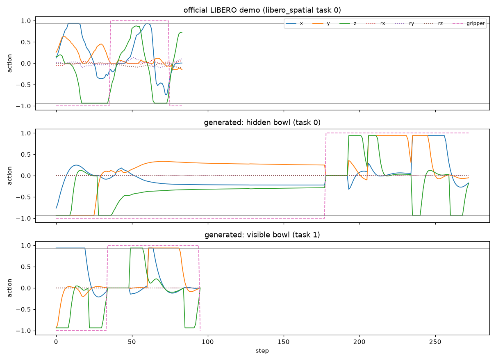

# デモの自動生成: hidden_cabinet_v1

- 日時: 2026-10-14
- 実行: `uv run python vla3dsg/scripts/generate_demos.py --name hidden_cabinet_v1 --suite vla3dsg_hidden --task-ids 0 1 --n-episodes 50`
- データセット: `vla3dsg/data/hidden_cabinet_v1/`（LeRobot v3.0 形式、132MB、git 管理外。repo_id は `vla3dsg/hidden_cabinet_v1`）
- 記録: `summary.json`（タスクごとの本数・試行回数・ステップ数）、`conditions.json`（制御の設定・git）、`episodes.jsonl`（エピソードごとのシードと開始時の SG）
- 確認用の動画: `videos/episode_{0,1,50,51}.mp4`（データセットから書き出したもの。0・1 が隠れあり、50・51 が見える）、`videos/compare_with_official.mp4`（公式デモと縦に並べ、各ステップの動作の指令を表示したもの）。動画は git 管理外
- 動作の指令のグラフ: `actions_vs_official.png`（公式デモ・隠れあり・見える、の 1 エピソードずつ）

## 方法

- タスク: 実験2 の自作スイート `vla3dsg_hidden` の task 0（キャビネットの裏に隠れたボウル）と task 1（キャビネットの横の見えるボウル）。成功条件はどちらも「ボウル 1 が皿の上」
- 配置: BDDL の配置範囲から、評価の初期状態（シード 0〜）とは別のシード（100000〜）でサンプリング。押し出し・転倒した配置は除く
- 動作: 評価と同じく初期状態を設定して 50 ステップ待ったあと、スクリプト制御（`vla3dsg/demos/scripted.py`）で掴んで置く
  - task 0: ロボット側の縁を掴み、キャビネットを避ける経由点（手前側）を通って皿へ
  - task 1: ボウルがキャビネットのすぐ横にあり、ロボット側の縁ではグリッパーがキャビネットに当たるため、反対側の縁を掴む
  - 経由点は水平に ±2cm ずらす。掴む点はずらさない（0.5cm ずらすだけで半分ほど掴み損ねたため）
- 成功し、評価の最大ステップ数（300）に収まったエピソードだけを保存
- 形式は `lerobot/libero` と同じ（画像 256×256 を 180° 回転、状態 8 次元 = 手先の位置・軸角・グリッパー、動作 7 次元、fps 10 の表記）。指示文はタスクの元の指示文（SG なし）

## 結果

| タスク | 本数 | 試行 | 除外 | ステップ数 | フレーム数 |
|---|---|---|---|---|---|
| task 0（隠れあり） | 50 | 52 | 配置 1、失敗 1 | 269〜279 | 13,718 |
| task 1（見える） | 50 | 50 | なし | 92〜234 | 5,178 |

- 生成にかかった時間は 13 分
- `lerobot-train` でこのデータセットから学習が回ることを確認（20 マイクロバッチ、メモリ・速度は `lerobot/libero` と同じ）

## 注意: 動作の分布が LIBERO の公式デモと違う

| | 移動の指令の平均の大きさ（x, y, z） | 上限 ±0.9375 付近（\|a\| > 0.9）の割合 | 回転の指令の平均の大きさ |
|---|---|---|---|
| `lerobot/libero`（公式デモ、先頭 1.4 万フレーム） | 0.21, 0.25, 0.27 | 0.3%, 0.1%, 2.0% | 0.02, 0.04, 0.05 |
| 本データセット | 0.25, 0.35, 0.40 | 13%, 23%, 22% | 0（常に 0） |

- スクリプト制御は比例制御を上限で切っているため、遠くへ動くときは上限に張り付き、回転はしない。人によるデモより機械的
- 学習の最初の損失（action flow loss）は、公式デモでは約 0.08 なのに対し、本データセットでは約 1.0 だった。新しい動作であることに加え、この動作の分布の違いも効いていると考えられる

## 問題点（2026-10-15、公式デモとの比較）

公式デモ（`lerobot/libero` の episode 1272、libero_spatial task 0、84 ステップ）と、生成したデモ（episode 0: 隠れあり 273 ステップ、episode 50: 見える 96 ステップ）の動作の指令。

1. **隠れありのデモの約半分は、手先が止まったまま押し続けている（最大の問題）**
   - 掴む高さの目標（ボウルの原点 +1cm、z ≈ 0.908）まで下りきれず、z ≈ 0.920 で止まる（指がボウルの縁などに当たるためと考えられる。接触は未確認）。目標に届かないので、`go()` の上限 150 ステップまで、小さな指令（x −0.2, y +0.3, z −0.3）を出し続けて待つ
   - 手先の移動が 1mm 未満のステップは、episode 0・1・20 でそれぞれ 138・142・139 ステップ（全体の約半分）。グラフの 35〜178 ステップの平らな区間がこれにあたる
   - このまま学習すると、「物体の上で止まって押し続ける」動作を覚えるおそれがある。デモが 270 ステップ以上と長い（公式は 100 ステップ前後）のもこのため
2. **回転の指令が常に 0**。公式デモには小さな回転（±0.1 程度）がある
3. **軸ごとに順に動く**。持ち上げ（z）→ 経由点へ（y）→ 皿の上へ（x）が、それぞれ上限に張り付いたまま切り替わる。公式デモも上限に張り付く区間はあるが、複数の軸が同時になめらかに変化する
4. 見えるボウル（task 1）には 1 の止まる区間はなく、長さも公式に近い（96 ステップ）。2・3 は同じ

直し方の案: 目標に近づかなくなったら（数ステップ動かなければ）次の動作へ進む、掴む高さの目標を実際に届く高さにする、移動の向きを 3 軸同時に（ベクトルの大きさで）制限して加減速をなめらかにする
