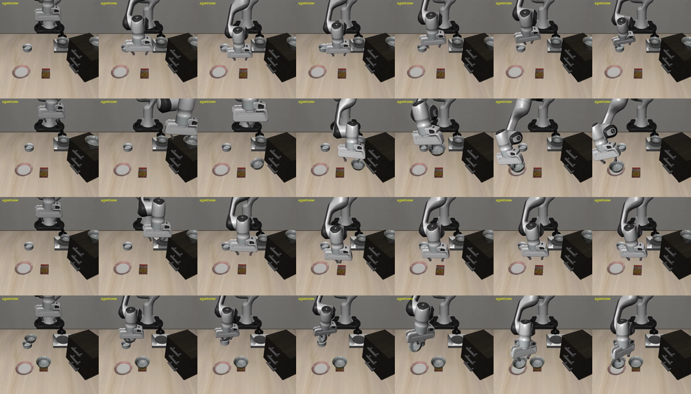

# 実験1（追加学習なし）: 標準 LIBERO（libero_spatial）で SG をテキストとして指示文に追加

- 日時: 2026-10-13
- 実行: 条件ごとに `uv run python vla3dsg/scripts/run_eval.py --name exp1/libero_spatial_n5/<条件> --suite libero_spatial --n-episodes 5 --prompt-condition <条件> --annotated-video`
- 集計: `uv run python vla3dsg/scripts/summarize_results.py --root exp1/libero_spatial_n5 --names A B1 B2 B3 C D`（`comparison.md`）
- 共通条件: チェックポイント `allenai/MolmoAct2-LIBERO`（float32）、`num_steps_wait=50`、シード 1000、`--policy.normalize_language=false`（元の指示文だけを正規化）、`--policy.max_sequence_length=1024`
- コミット: `e13ec39c` に SG・プロンプト条件の未コミットの実装が乗った状態（各 `conditions.json` の `dirty: true`）。実装は本結果と同じコミットで追加
- 所要時間: 条件ごとに 531〜710 秒（SG を加えた条件は、プロンプトが長いぶん遅い）
- 各条件のディレクトリ: `summary.json`（成否）、`prompts.jsonl`（エピソードごとに実際に使ったプロンプトと SG）、`videos/`（全エピソードの動画、git 管理外）

## 条件

| 条件 | プロンプト（`<指示文>. scene information: <追加テキスト>`） |
|---|---|
| A | 元の指示文のみ |
| B1 | SG（JSON） |
| B2 | SG（三つ組の列挙） |
| B3 | SG（自然文） |
| C | SG（JSON）と同じトークン数の無関係な文 |
| D | 物体名を入れ替えた SG（JSON） |

SG はエピソード開始時（物体が落ち着いた後）のシミュレータの状態から作った正解（`vla3dsg/scene_graph/`）。ノードは物体 7 つ（同種のボウルは "black bowl 1/2"）、エッジは on / in（引き出し・棚の上面・コンロ）と、agentview から見た前後左右（各物体の近い 2 物体）で、1 シーンあたり 10 本前後。

プロンプトの例（task 0、条件 B2）:

```
pick up the black bowl between the plate and the ramekin and place it on the plate. scene information: (black bowl 1, behind, plate); (black bowl 1, in front of, ramekin); (black bowl 2, left of, ramekin); (black bowl 2, behind, black bowl 1); (cookie box, right of, plate); ...
```

## 結果

| 条件 | 成功率 | A との差の検定（Fisher の正確検定） | プロンプトの長さ（トークン、中央値） |
|---|---|---|---|
| A | 96.0%（48/50） | — | 16 |
| B1（JSON） | 90.0%（45/50） | p = 0.44 | 187 |
| B2（三つ組） | 86.0%（43/50） | p = 0.16 | 126 |
| B3（自然文） | 82.0%（41/50） | p = 0.051 | 128 |
| C（無関係な文） | 92.0%（46/50） | p = 0.68 | 187 |
| D（入れ替えた SG） | 94.0%（47/50） | p = 1.00 | 188 |

タスクごとの成功回数は `comparison.md`。

- 条件 A は、ベースライン（`results/baseline/all40_n5` の libero_spatial）と全 50 エピソードの成否が一致した。正規化の切り替えと系列長の上限の変更は結果に影響していない
- SG を加えても成功率は上がらず、どの形式でもやや下がった（自然文が最も低い）。ただし各条件 50 エピソードでは、A との差は有意ではない（B3 が p = 0.051 で境界）
- 無関係な文（C）や、物体名を入れ替えた誤った SG（D）でも、正しい SG（B1）と同程度だった。追加情報の中身によらず、プロンプトが長くなる・形が変わること自体の影響のほうが大きい。少なくとも追加学習なしの MolmoAct2 は、SG の内容を行動に活かしていない
- 成功率が下がったのは主に task 7（コンロの上のボウル、B3 で 2/5）と task 5（ラメキンの上のボウル）。task 4（引き出しの中のボウル）は A でも失敗があり、全条件で 3〜4/5

## 失敗の様子



上から B3 task 7 ep 1、B3 task 7 ep 4、B2 task 7 ep 2、B3 task 5 ep 0（agentview、40 ステップおき）。

- 見た範囲では、対象と違うボウルを掴みにいく失敗はなかった。正しい対象（コンロの上・ラメキンの上のボウル）の近くまで行き、その上で迷うように止まって掴めない、または運んだ後に置き終わらず時間切れになる
- 指示文が学習時の分布（短い LIBERO の指示文）から外れたことで、動作が不安定になったと考えられる

## 考察と次の検討

- LIBERO の標準タスクでは、対象は画像から見えており、指示文だけで十分に特定できる（A で 96%）。SG が助けになる余地が小さい設定であり、「SG が効かない」というより「余計な文が入ると少し乱れる」という結果
- SG の効果を見るには、画像だけでは対象を特定できない状況（実験2: 隠れた物体）が必要
- 追加学習なしでプロンプトに入れる場合は、短く・学習時の指示文に近い形のほうが悪影響が小さい可能性がある（例: 対象に関係する関係だけを 1 文で加える）
- 50 エピソードでは差を検出しにくい。条件を絞って回数を増やすことも検討する
