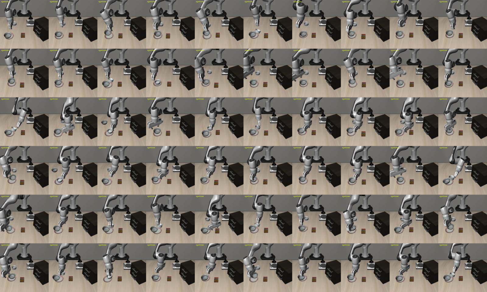

# 実験2（追加学習なし）: キャビネットの裏に隠れたボウルで SG をテキストとして指示文に追加

- 日時: 2026-10-13
- 実行: 条件ごとに `uv run python vla3dsg/scripts/run_eval.py --name exp2/hidden_cabinet_n20/<条件> --suite vla3dsg_hidden --n-episodes 20 --prompt-condition <条件> --annotated-video`
- 集計: `uv run python vla3dsg/scripts/summarize_results.py --root exp2/hidden_cabinet_n20 --names A B1 B2 B3 C D`（`comparison.md`）
- 共通条件: 実験1 と同じ（チェックポイント `allenai/MolmoAct2-LIBERO`（float32）、`num_steps_wait=50`、シード 1000、`--policy.normalize_language=false`、`--policy.max_sequence_length=1024`）。最大ステップ数 300（元の libero_spatial は 280）
- コミット: `b0e64fe0` に自作スイートの未コミットの実装が乗った状態（各 `conditions.json` の `dirty: true`）。実装は本結果と同じコミットで追加
- 所要時間: 条件ごとに約 12〜13 分（計約 76 分）
- 条件（A〜D）とプロンプトの作り方は実験1（`../../exp1/libero_spatial_n5/README.md`）と同じ

## シーン（自作スイート `vla3dsg_hidden`、`vla3dsg/custom_tasks/vla3dsg_hidden/`）

libero_spatial task 0（皿とラメキンの間のボウルを皿に置く）を元に、対象のボウル（`akita_black_bowl_1`）の配置範囲だけを変えた。成功条件は元と同じ（ボウル 1 が皿の上）。もう 1 つのボウル（ボウル 2）・皿・ラメキンなどの配置は元と同じ。

| task | 指示文 | 対象の配置 | agentview から見える割合 |
|---|---|---|---|
| 0（隠れあり） | pick up the black bowl behind the wooden cabinet and place it on the plate | キャビネットの裏（x ≈ -0.20, y ≈ -0.33） | 0.0（50 件すべて） |
| 1（隠れなし、対照） | pick up the black bowl next to the wooden cabinet and place it on the plate | キャビネットの手前の横（x ≈ 0.0, y ≈ -0.08） | 1.0 |

- 見える割合は、対象のメッシュの頂点から最大 400 点へ agentview から光線を飛ばし（`mujoco.mj_ray`）、キャビネットをどけた場合に見える点の数に対する割合（`make_custom_task.py`）。task 0 は初期姿勢の手首カメラの画角にも入らない
- 初期状態は各 50 件。配置後に押し出された・倒れたもの（task 0 で 2 件）は除いた
- 対照（task 1）について: キャビネットの裏のまま見える位置を作ろうとしたが、キャビネットの右側は agentview の画角の外になるため、「キャビネットの横（見える）」にした。そのため task 0 と task 1 は、隠れの有無に加えて指示文（behind / next to）と位置も違う

初期画像（agentview・手首カメラと、真上・横などの確認用の視点）: [overview.png](../../../custom_tasks/vla3dsg_hidden/previews/overview.png)

task 0 のプロンプトの例（条件 B2）。SG には対象の隠れ場所（キャビネットの裏）が入る:

```
pick up the black bowl behind the wooden cabinet and place it on the plate. scene information: (black bowl 1, behind, wooden cabinet); (black bowl 1, right of, stove); (black bowl 2, left of, ramekin); (black bowl 2, behind, plate); (cookie box, right of, plate); ...
```

## 結果

| 条件 | task 0（隠れあり） | task 1（隠れなし） | プロンプトの長さ（トークン、中央値） |
|---|---|---|---|
| A（元の指示文のみ） | 0/20 | 20/20 | 16 |
| B1（SG、JSON） | 0/20 | 20/20 | 188 |
| B2（SG、三つ組） | 0/20 | 20/20 | 128 |
| B3（SG、自然文） | 0/20 | 20/20 | 130 |
| C（無関係な文） | 0/20 | 20/20 | 188 |
| D（入れ替えた SG） | 0/20 | 20/20 | 192 |

- 隠れあり（task 0）はすべての条件で 0/20、隠れなし（task 1）はすべての条件で 20/20。SG の有無・形式による差はまったく出なかった（検定するまでもなく同じ）
- 隠れなしでは、指示文が学習時と違う（"next to the wooden cabinet"）・位置が違うシーンでも全条件で成功しており、実験1 で見られた SG による低下も出なかった

## 失敗の様子（task 0）



上から条件 A・B2・D の、各 20 エピソードの最後のフレーム（agentview）。

- どの条件でも、ロボットはキャビネットの方へまったく向かわない。見えている方のボウル（ボウル 2）を掴んで皿に置く（皿の上にボウルが載った状態で終わる）か、ラメキンなど近くの物体を触って時間切れになる
- つまり MolmoAct2 は、画像に見えている「元のタスクで掴むはずの物体」へ行く動作を実行しており、指示文の "behind the wooden cabinet" も SG の位置関係も行動に反映していない

## 考察と次の検討

- 追加学習なしの MolmoAct2 は、画像に見えない物体を言語の情報（指示文・SG）だけから探しに行くことはできない。指示文の場所の指定さえ使っておらず、シーンの見た目からタスク（libero_spatial task 0 の動作）を決めていると考えられる
- 実験1 と合わせると、追加学習なしでは SG をテキストで与えても効果がない。SG を使わせるには追加学習が必要
- 注意: キャビネットの裏のボウルがロボットにとって物理的に掴めるか（届く・干渉しない）は確認していない。追加学習のデータを作る前に、スクリプトの動作（または遠隔操作）で到達できることを確かめる必要がある
- 隠れなしの対照は指示文と位置も違うため、厳密な対照ではない。隠れの効果だけを見るには、同じ指示文で遮る物体だけを除いたシーン（例: キャビネットを取り除く）も候補になる
