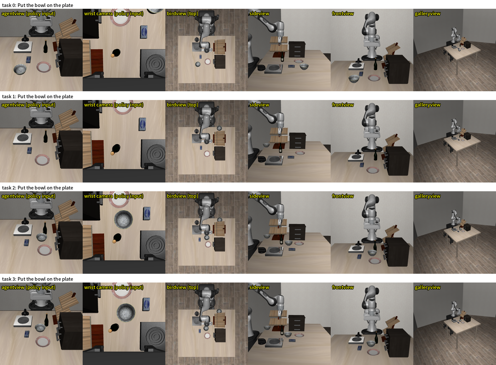
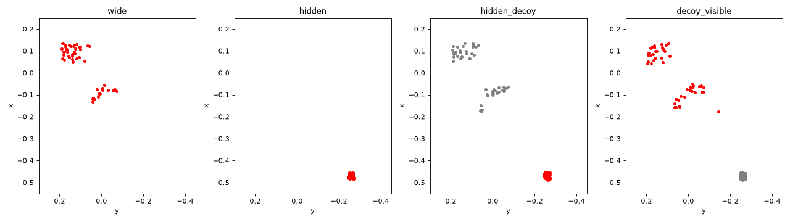

# ゼミ報告（2026-10-28）: VLA×3DSG の進捗

モデルは MolmoAct2（LIBERO 向けにファインチューニング済みの `allenai/MolmoAct2-LIBERO`）。元にするタスクは libero_goal「put the bowl on the plate」（黒いボウルを皿に置く）。動画は `videos/`（git 管理外）。比較動画は `layouts/*.json` の並べ方で `scripts/make_comparison_video.py --layout <JSON>` から作り直せる。

前回（2026-10-21）の結論: 追加学習なしでは、指示文に加えた SG の中身は使われず、隠れたボウルはどの条件でも取りに行かない。今回は、追加学習の前に分かった **ベースモデルの配置の変化への弱さ** と、そのための **学習用データセットの作成** を報告する。

## 1. ベースモデルは、ボウルの位置が学習時と違うと失敗する（追加学習なし、公式の指示文のみ）

### 方法

- 前回、物体の場所を入れ替えたシーン（場所シャッフル）では、公式の指示文のみの成功率が 10% だった（標準のシーンは 95%）。4 物体を一度に動かしたため、どの物体の移動が効いたか分からない
- 標準の配置から **ボウルか皿の一方だけ** を動かした 7 シーン（`custom_tasks/vla3dsg_goal_layout/`）を作り、公式の指示文「put the bowl on the plate」のみで各 20 エピソード評価した。ロボットからボウルまでの距離と、ボウルと皿の距離のどちらが効くかを分ける
- あわせて、公式の学習データ（`lerobot/libero`）で、デモがどこでボウルなどを掴んでいるかを調べた。MolmoAct2-LIBERO の正規化の統計のフレーム数（273,465）がこのデータと一致し、同じデモで学習したと考えられる

### 結果（`results/zeroshot/layout_check/`）

距離は初期状態 0 での水平距離（ロボットから = 開始時の手先からボウルまで）。

| シーン | ロボットからボウルまで | ボウルと皿の距離 | 成功率 | スクリプト制御 |
|---|---|---|---|---|
| 標準（参考） | 0.12m | 0.16m | 95% | 10/10 |
| ボウルを近くへ（コンロの手前） | 0.06m | 0.24m | 100% | 5/5 |
| 皿を左へ | 0.12m | 0.23m | 100% | 5/5 |
| 皿を遠くへ | 0.12m | 0.26m | 95% | 5/5 |
| 皿をボウルの隣へ | 0.12m | 0.12m | 100% | 5/5 |
| ボウルを場所シャッフルの位置へ（手前左、皿の隣） | 0.30m | 0.11m | **5%** | 5/5 |
| ボウルを遠くへ（さらに手前、皿の隣） | 0.37m | 0.12m | **0%** | 4/5 |
| ボウルを遠く、皿から離して（手前左の奥） | 0.38m | 0.23m | **5%** | 3/5 |

公式の学習データで、最初に掴んだときの手先の位置:

| データ | 本数 | 掴んだ位置の x（大きいほど手前） | 開始時の手先からの距離 |
|---|---|---|---|
| 「put the bowl on the plate」 | 49 | −0.12〜−0.06（ばらつき約 1cm） | 0.10〜0.15m |
| libero_goal 全体 | 428 | 0.00 より手前に来ない | 最大 0.32m |
| libero_spatial | 432 | 0.16 まで | 最大 0.39m |

- 皿を動かしても、ボウルと皿を近づけても下がらない（95〜100%）。ボウルをロボットから遠い手前に置くと、皿の隣でも離しても失敗する（0〜5%）→ 場所シャッフルでの低下は **ボウルが学習時よりロボットから遠いこと** による
- どのシーンもスクリプト制御では成功する（物理的にはできる）
- 学習データの libero_goal のシーンでは、ボウルはいつも同じ場所にあり、手前で掴むデモは 1 本もない。ほかのスイートでは手前まで腕を伸ばして掴んでいる。このシーンで、ボウルの位置に合わせて動きを変えることを学んでいないことが原因と考えられる（推測）
- 失敗の仕方は、学習時のボウルの位置の上で止まる、ボウルを置いたまま皿の方へ行く、クリームチーズを皿に置く、ボウルを皿の縁に置く、とばらばら（動画で確認した一部のエピソード）
- 試した遠い位置はすべてテーブルの手前（カメラ側）で、左右に遠い場合は確かめていない
- 追加学習で隠れたボウルを取れるようにしても、見えるボウルの位置が少し変わるだけで失敗するなら意味が薄い。学習データでは、見えるボウルの位置も広く変える（2）

### 動画

- `videos/1_layout_check.mp4`（`layouts/1_layout_check.json`）: 各シーンの episode 1 を「ボウルがロボットに近い」「遠い」で分けて並べた比較。ボウルが近ければ皿の位置によらず成功し、遠ければ皿の隣でも離しても失敗する（皿から離したシーンでは、学習時のボウルの位置の上で止まる）

## 2. 学習用データセットの作成

### 方針

- 隠れたボウルを取るデモは公式データにないため、シミュレータでスクリプト制御（物体の正確な位置を読み、決めた手順で掴んで置く。`demos/scripted.py`）で作る
- 次の 2 つを同時に学ばせるシーンにする
  - 隠れたボウル（ワインラックの裏）を、SG を手がかりに取る
  - 見えるボウルを、広い範囲のどこにあっても取る（1 の弱さへの対策）
- **SG を読まないと解けない** シーンを入れる: ボウルを 2 つ置き、一方を隠す。正解を隠れた方・見える方で半々にする。画像も指示文も同じで、SG だけが違うため、SG なしのモデルは 50% が上限になる

### シーン（スイート `custom_tasks/vla3dsg_goal_train/`）

指示文はすべて「Put the bowl on the plate」。最大 400 ステップ。

| シーン | 配置 | 正解のボウルが見える割合 | 短い SG の例 |
|---|---|---|---|
| 見える（広い範囲） | ボウルを広い範囲（x −0.22〜0.16、y −0.10〜0.22）に置く。ほかは標準 | 99〜100% | (black bowl, left of, wooden cabinet) |
| 隠れている | ボウルをワインラックの裏に置く（前回の評価の「標準＋隠れ」と同じ） | 0% | (black bowl, behind, wine rack) |
| 隠れた方が正解 | 隠れた正解＋見えるおとりを広い範囲に | 0% | (black bowl 1, behind, wine rack) |
| 見える方が正解 | 見える正解を広い範囲に＋隠れたおとり | 99〜100% | (black bowl 1, left of, wooden cabinet) |

- 見える割合: カメラ（agentview）から対象の表面の点へ光線を飛ばし、遮る物体をどけた場合に対して何 % が直接見えるか
- 短い SG: シミュレータの正解の状態から作る、掴む対象についての関係だけの SG（作り方は前回の報告の 2）。正解のボウルとおとりを見分ける関係が選ばれる

- 広い範囲は皿・クリームチーズ・ワイン瓶・コンロと重なるため、物体どうしが 11cm より近い、物がほかの物に乗った・触れた、評価と同じく読み込んで待つあいだに 2cm 以上動いた配置を除いた（`make_custom_task.py --min-distance`。約 8 割を除外）。デモの配置も同じ基準で除く
- 見えるボウルの位置は、ほかの物体を避けて 3 つのまとまり（標準の位置の付近、ロボット寄りの左、遠い左手前）になり、一様には散らばらない（下の図。赤が正解、灰色がおとり）。遠い左手前は、1 で公式の指示文が 0〜5% だった位置を含む

- 2 か所目の隠し場所は作れなかった（木のキャビネットの裏はワインラックとの隙間が 3.4cm でボウルが入らない。コンロは高さ約 7cm で隠れない）。このため、おとりのない「隠れている」は、SG を読まなくても「見えなければラックの裏」で解けてしまう。SG が必要なのは、ボウル 2 つの組だけ

### スクリプト制御のデモの多様性

同じ動きばかりのデモにならないよう、デモごとに次をランダムに変える（`settings.DEMO_*`）。

- 掴む向き: ボウルの縁のどこを掴むか（中心から見た角度。0° = 手前、90° = 左、180° = ロボット側）。手先の向きを合わせ、指が縁の壁を挟む形は保つ。掴める範囲は位置で違うため、16 か所 × 30° ごとに試して決めた

| ボウルの位置 | 全か所で成功した角度 | 設定した範囲 |
|---|---|---|
| ロボット寄り（x < 0） | 0〜150° | 0〜150° |
| 遠い左手前（x > 0） | 180°（ロボット側の縁）のみ | 170〜190° |
| ワインラックの裏 | 75〜120° | 75〜120°（手前を回る経由点を通る） |

- 高さ: 近づく・運ぶ・経由点の高さを ±3cm
- 経由点: 半分の確率で、まっすぐな経路の中点を横に ±8cm ずらした点を通る
- 速さ: 上限に 0.7〜1.0 倍を掛ける。移動・回転の指令にも小さな揺らぎを入れる

### 結果

評価用の初期状態でのスクリプト制御の確認（ランダム化あり、各 10 回。`results/demos/check_goal_train/`）:

| シーン | 成功 | ステップ数 |
|---|---|---|
| 見える（広い範囲） | 10/10 | 139〜201 |
| 隠れている | 10/10 | 282〜364 |
| 隠れた方が正解 | 10/10 | 275〜367 |
| 見える方が正解 | 10/10 | 137〜178 |

生成したデータセット（`data/goal_train/`、記録は `results/demos/goal_train/`）:

| シーン | デモ | 試した配置 | 除いた配置 | 失敗・時間切れ | ステップ数 |
|---|---|---|---|---|---|
| 見える（広い範囲） | 50 | 207 | 157 | 0 | 128〜233 |
| 隠れている | 50 | 51 | 0 | 1 | 262〜387 |
| 隠れた方が正解 | 50 | 300 | 247 | 3 | 260〜399 |
| 見える方が正解 | 50 | 306 | 255 | 1 | 126〜211 |
| 計 | **200**（47,562 フレーム） | | | | |

- 配置は評価用の初期状態とは別のシードで選ぶ（評価の初期状態でのデモにはしない）。このPCで 52 分
- 失敗・時間切れ（最大 400 ステップ超え）のデモは保存しない。どのシーンも 98% 以上で成功した

公式デモ（「put the bowl on the plate」の 20 本）との比較（各シーン 20 本。`results/demos/goal_train/report.json`）:

| | 公式 | 見える（広い範囲） | 隠れている | 隠れた方が正解 | 見える方が正解 |
|---|---|---|---|---|---|
| 平均のステップ数 | 95 | 162 | 312 | 316 | 164 |
| 手先がほぼ止まっているステップの割合 | 6% | 9% | 13% | 12% | 8% |
| 移動の指令が上限に達する割合（x / z） | 12% / 14% | 0% | 0% | 0% | 0% |

- 見えるボウルのデモは公式の約 1.7 倍長い。スクリプト制御は上限まで速く動かさず、手先が止まる時間もやや多い。この癖が学習に与える影響は未検証（学習したモデルが公式より遅く動く可能性がある）

- 観測と動作は公式データ（`lerobot/libero`）と同じ形式（agentview と手首カメラの画像 256×256、手先の状態 8 次元、動作 7 次元。fps の表記も公式と同じ 10）。そのまま公式デモと混ぜて学習できる
- 指示文は公式の文のまま保存し、エピソード開始時の SG を `episodes.jsonl` に記録した。SG を加えた指示文のデータは、条件ごとに後から作る

### 動画

- `videos/2_train_scenes.mp4`（`layouts/2_train_scenes.json`）: 4 シーンで、スクリプト制御がボウルを皿に置く様子（評価用の初期状態 0）。右の 2 つは見た目も指示文もほぼ同じだが、正解のボウルが違う

## まとめと次の予定

- ベースモデルは、見えるボウルでも学習時より遠い位置にあると失敗する（0〜5%）。公式の学習データでは、このシーンのボウルはいつも同じ場所にある
- 学習用に、見えるボウルを広い範囲に置くシーン、隠れたボウルのシーン、SG を読まないと正解が分からない 2 つのボウルのシーンを作り、スクリプト制御でデモを作った
- 次: 追加学習（LoRA）
  - 同じデモで、SG なし／＋短い SG の 2 モデルを学習し、前回と同じ表（標準・場所シャッフル・隠れ・隠れ（おとりあり））と、学習用シーンの評価用の初期状態で比べる
  - 誤った SG で成功率が下がれば、SG の中身を使っていると確かめられる
  - 公式の libero_goal のデモ（428 本）を混ぜるか、SG を指示文にどう入れるかは相談して決める
